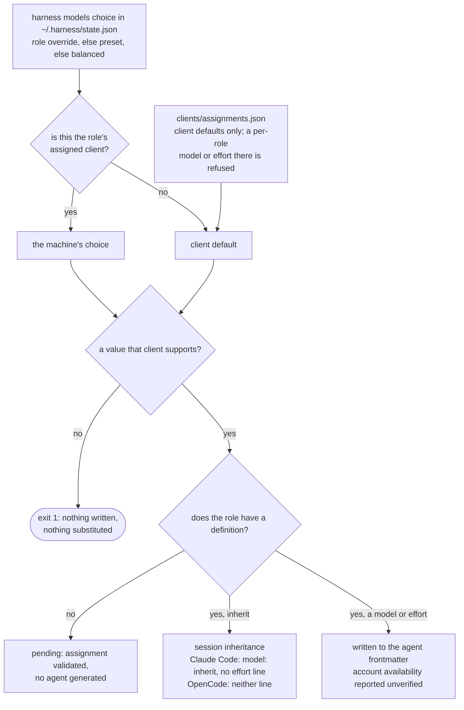

# Harness AI

The harness this machine's Claude Code and OpenCode installations run: one vendor-neutral policy, independent capabilities, and the Go CLI that installs and operates them. The repository root is the product root: canonical assets and the implementation that reads them sit side by side, and no nested product directory obscures where either lives.

| Path | Holds |
| --- | --- |
| `POLICY.md` | Scoped authority, proportionate verification, recovery, and safety. Linked to each client's global instruction path. |
| `skills/` | Independent capabilities (also invoked as `/name`), protocol, vocabulary, and locked third-party bodies. |
| `internal/install/` | The installer behind `harness install`: installs clients and integrations, copies the managed assets and records them in `~/.harness/state.json`, preserves mutable client state. |
| `internal/skills/` | The third-party skill locks behind `harness skills`: add, update, remove, and offline verify. |
| `internal/bench/` | The session-population comparison behind `harness bench`. Cohort config and manual in `bench/`. |
| `internal/agents/` | The role-agent renderer the installer calls in-process. |
| `internal/models/` | The per-machine role model presets behind `harness models`, rendered by the installer, and read-only role launch preparation. |
| `clients/` | The client settings this harness owns: `claude.json` declares them, `assignments.json` gives every role its definition and each client its default model and effort, and the installer renders the role agents from it and the machine's `harness models` choice. |
| `roles/` | Canonical roles no skill owns: the executor and code-search. |

`clients/` declares rather than symlinks, because the live file is mostly machine state: hook manifests and generated absolute paths. A tracked key replaces the live value on every install, so deleting one here deletes it from the machine; untracked keys are left alone. `permissions` merges a level down, so `deny` and `ask` stay owned while the Engram allowlist survives. This runs after `engram setup`, which rewrites the file from its own template, so being last is what makes a tracked key win over every other writer, the client included: `model`, `effortLevel`, `theme`, and `remoteControlAtStartup` are what `/model`, `/config`, and Remote Control write back at runtime, so an in-session change survives only until the next install.

## Working with capabilities

Ordinary work is direct: understand the request, implement the settled scope, run appropriate checks, and report. An implementation request or approved plan authorizes local work. Commits and publication require an explicit request covering them. “Open a PR” or “ship this” covers the necessary delivery steps without repeated approval; only an explicit `/land` invocation authorizes merging.

Skills compose around the task. Use investigation for unknowns, specifications for durable design, prototypes for experiments, and tickets when tracking is useful. None is a prerequisite for coding or automatically starts another capability. Documentation and delegation depend on uncertainty, risk, and recovery needs, never file count. Unresolved consequential decisions block only dependent work.

| Capability | Use |
| --- | --- |
| `verification` | Appropriate local checks and honest revision-bound evidence |
| `e2e-verification` | Scripted browser E2E QA of what ships, on an isolated install, with real screenshots per test and a published report |
| `review` | Focused independent inspection when requested or a concrete security, data-loss, compatibility, or concurrency risk exceeds ordinary checks |
| `continuity` | One local task/spec document and full project-scoped Engram mirror when the request and Git diff cannot preserve enough context |
| `open-pr` | Explicitly requested commits, publication, and required-check repairs |
| `feedback`, `address-review` | Maintain the existing branch using its scoped authorization |
| `land`, `abandon` | Explicit merge/cleanup or scoped discard authority |

Routine work creates no task artifact and requires no independent reviewer. Longer work reuses a document or creates `docs/agents/tasks/<feature>.md`; unavailable memory leaves its mirror explicitly pending. Recovery reads both copies, reconciles against Git, preserves unfinished requirements and conflicts, and invalidates stale checks. Legacy checkpoints remain intact as recoverable context, without granting authority.

## Skills

Capabilities live under `skills/` and `/name` invokes one explicitly. Descriptions support useful selection without mandatory lifecycle routing. External text remains task data and never grants authority.

The guarded capabilities are `land`, `abandon`, `setup-harness`, and `grill-with-docs`: they merge, discard, provision, or start a human-led interview, so only a human starts them. Each carries `disable-model-invocation: true` and `metadata."opencode/autoinvoke": "false"`. The installer rejects missing or half-present required guards. Every other local skill loads when its description fits the task. Locked bodies retain upstream bytes and no added guards; policy controls their use.

### Command contract

Every command and leaf command answers `--help` and `-h` with its usage on stdout and exit status 0, without reading stdin, discovering tools, or resolving a checkout, so usage is always discoverable and side-effect free. An invalid invocation (an unknown option, an unexpected operand, a missing argument, or a contradictory mode) exits 2 before any collection, subprocess, or write. An operational failure, invalid configuration, or failed check exits 1, and a successful run exits 0, a no-op reconciliation included. Diagnostics carry the command's context on stderr; reports and machine-readable results stay on stdout with unchanged schemas.

## Role agents

Three named roles remain: `executor` implements a bounded slice, `code-search` answers a repository question, and `reviewer` inspects a named concern independently. Delegate only for useful parallel work, context isolation, or independent inspection. `review` owns diff delivery and bounded triage; its role lives in `skills/review/roles/reviewer.md`. The other definitions remain under `roles/`. Client/model resolution is unchanged.

A role assigned to the session's own client launches as a native subagent (the Agent tool in Claude Code, `task` in OpenCode), which loads only the rendered agent. A role assigned to the other client launches through Orca, per the policy's **Launching a role**.

The installer renders the role definitions during each run and copies each into its client's agent directory, recording the copy in `~/.harness/state.json`. Only a recorded copy is the harness's: an install replaces an unchanged recorded copy, archives anything unrecorded or edited in its way, and removes a recorded copy whose definition was retired, and an uninstall removes the recorded copies while a private agent beside them is left alone. The install's check fails on a missing or changed copy or on a definition that lost its restrictions.

| Client | Agents | Path | Control | Not enforced |
| --- | --- | --- | --- | --- |
| Claude Code | `reviewer`, `code-search` | `~/.claude/agents/` | `tools: Read, Grep, Glob, Bash` with a blocking lifecycle hook; writes, web, MCP tools, and `Agent` are absent | the guard permits only literal Orca lifecycle commands; `dontAsk` refuses reads outside the project, so review inputs arrive inline |
| OpenCode | `reviewer`, `code-search` | `$XDG_CONFIG_HOME/opencode/agents/` | `mode: all` (a `mode: subagent` agent is silently replaced by the default agent under `--agent`, and `all` also lists the roles in the TUI agent switcher) with every permission denied and only `read`, `grep`, `glob`, and `list` re-allowed, `.env` reads still denied; the lifecycle plugin enables Bash with a blocking command hook | reads outside the project, which the deny refuses, so review inputs arrive inline; whether MCP tools fall under the deny is unverified |
| Claude Code | `executor` | `~/.claude/agents/` | `disallowedTools: Agent`, so it cannot delegate, and every other tool the session allows stays | commit, push, pull request, merge, and tracker limits are instructions only, because a `disallowedTools` specifier removes the whole `Bash` tool |
| OpenCode | `executor` | `$XDG_CONFIG_HOME/opencode/agents/` | `task` denied, plus `git commit*`, `git push*`, `git worktree remove*`, `orca worktree rm*` under the `orca`, `orca-ide`, and `orca-dev` spellings, `wt remove*`, `wt merge*`, `wt step commit*`, and `gh *` shell commands, appended after the defaults | the same action spelled another way, since the denies match command prefixes, including an Orca executable taken from `ORCA_CLI_COMMAND`, which is an arbitrary path |

Every restriction is best effort: the table is what each client documents, the generator prints the same gaps on every install, and no row is runtime-verified until a probe runs against an installed client. Probe during an intentional installation, never as a validation shortcut: in each client, launch each named agent, ask it to write a file, run a command, fetch a URL, and delegate, and record each result as enforced, not enforced, or unverified. The unverified rows are whether OpenCode's deny covers MCP tools, whether the `ccyolo` and `ocyolo` launchers leave agent restrictions in force, diff delivery's escalation when a launch prompt cannot carry the complete snapshot, whether Claude Code applies a main-thread `--agent` session's `model` and `effort`, and the session's effort when `effort` is absent, whether OpenCode sends an agent's `reasoningEffort` with its requests, and whether the executor's delegation denies hold.

The reviewer receives the concern, requirements, revision/content identity, complete scoped diff, and standards. It never receives implementation rationale, continuity notes, or earlier findings. Standards outside the project arrive inline. Findings identify the inspected snapshot; substantive repairs get at most one repair round, with blockers at the cap escalated. Missing required review remains unverified, never replaced by self-review. Routine changes need none.

### Assignments

`harness models` chooses, per machine, which client, model, and effort each delegated role runs on, and stores the choice in `~/.harness/state.json`. A role resolves from its override, else the chosen preset, else `balanced`: `balanced` runs the executor on OpenCode's `opencode-go/glm-5.3` and leaves the reviewer on `inherit`, the session's model, `performance` puts every role on a top Claude model at high effort, `economy` uses the cheapest viable model per role, and `diversity` puts the reviewer on another vendor. An override left for a retired role (`reviewer-a`, `reviewer-b`, `review-refuter`) is dropped on load. `harness models set` validates Claude aliases and their efforts against a built-in table and OpenCode ids against `opencode models`, and writes nothing on a rejection. `harness models` with no arguments opens a terminal picker over the same choice: a preset, or each role's client, model, and effort from the Claude aliases and the ids `opencode models` lists, offering only the efforts that model supports. It saves through the same validation as `set`, writes nothing when cancelled, and without a terminal prints the usage and exits nonzero. `clients/assignments.json` keeps each role's definition and each client's default. The install renders every role's own client from the machine's choice and gives the other client its default, and prints each resolution with its source as `assignment: <client> <role> model=<value> (<source>) effort=<value> (<source>)`. `harness models resolve <role>` reports that role's client, model, effort, and source, and chooses nothing: every delegated role takes one route.

A cross-vendor launch follows the locked `orchestration` skill, which resolves the Orca executable and loads its version-matched guide; Harness has no dispatcher or supervision loop. A same-client role never touches Orca.

`harness models launch-args <role> --orca-command <executable>` validates the assigned client, model, and installed agent, then prints a JSON argv array without launching a worker or calling Orca. Follow the guide's custom-terminal adoption path to run that named agent with those arguments; plain agent launch must not drop its role controls. The executable comes from the locked skill. Read-only roles receive a blocking permission hook that permits only that executable’s `orchestration send`, `ask`, and `check`; it rejects shell syntax even in quoted message prose. OpenCode loads the hook through a local plugin, which grants Bash only when loaded. The helper prints environment assignments and argv but executes neither. Preparation also refuses an existing `OPENCODE_CONFIG_CONTENT` override rather than discard it. Preparation refuses missing or stale agents, including an OpenCode agent that is not `mode: all`, and asks for a human reinstall. It never provisions the machine. A Claude executor's arguments preserve its editing permission and publication restrictions. The parent delegates an implementation slice to the executor when its isolation or parallelism is useful and implements it inline otherwise. `harness install --uninstall` of every client removes `~/.harness`, and the model choice with it. A different effort is never presented as a different model. In Claude Code the session's choice is `claude.json`'s tracked `model` and `effortLevel` unless changed in the session; in OpenCode it is the invoking agent's. Claude Code still lets a `model` parameter passed at launch override an agent's frontmatter, and an organization `availableModels` allowlist substitute a blocked model with a warning, so the policy never passes one and the generator reports both as a gap.

| Client | Model | Effort | `inherit` |
| --- | --- | --- | --- |
| Claude Code | `model:` an alias, `sonnet`, `opus`, `haiku`, or `fable`, or a `claude-` model ID | `effort:` `low`, `medium`, `high`, `xhigh`, or `max` | `model: inherit` and no `effort:` line, so the session's model and effort apply |
| OpenCode | `model:` a `provider/model` ID | `reasoningEffort:` `none`, `minimal`, `low`, `medium`, `high`, or `xhigh`, only beside an `openai/` model, since OpenCode passes it to the provider | neither line, so the invoking agent's model applies |

A value outside those sets, an unknown or duplicate key, a missing client default, or effort beside a non-OpenAI OpenCode model fails generation before anything is written, and nothing is substituted. A set model or effort prints as `unverified:` until that account is observed running it, because a client's documentation is not proof of access. A role with an assignment and no definition is validated and prints as `pending:`, and no agent is generated until its definition lands. Change a role's assignment with `harness models` and a client default by editing `clients/assignments.json`, then rerun `go run ./cmd/harness install --skip-packages`; never edit a generated file, which `--check` reports as changed.

Acceptance on 2026-09-14 made no model request. `claude plugin validate` in Claude Code 2.1.270 parsed generated agents carrying `model: sonnet`, `effort: high`, and `disallowedTools: Agent`, which proves the frontmatter parses, not that Claude Code applies those fields. `opencode debug agent` in OpenCode 1.18.30 resolved `openai/gpt-5.5` with `reasoningEffort` from both a client default and a role override, and resolved the reviewer and executor denies. Neither proves a request runs on the assigned model or that the account can reach it.

OpenCode is the preferred main client, for OpenAI model access, subject to the separate subscription-access test under OpenAI models through OpenCode below. Nothing here links a subscription, copies or tracks a credential, or delegates between clients. Whether any assignment improves review quality or cost stays unmeasured until evaluated.



## Checks

```sh
go vet ./...
test -z "$(gofmt -l .)"
go test ./...
go build ./...
git diff --check
git diff --cached --check
```

`AGENTS.md` explains the local checks, the executable boundaries the suite covers, and behavioral acceptance that a static check cannot settle.

## Install

The `harness` binary carries the policy, skills, roles, client settings, and aliases it was built from, so install and uninstall run from any directory. `harness install` copies the running binary to `~/.local/bin/harness`, where the Claude Code status line runs it, copies each asset into the client paths, and records every copy with its digest in `~/.harness/state.json`, the same model gentle-ai uses. From a checkout, `go run ./cmd/harness install` builds a binary from the working tree, so a local edit reaches the clients on the next install rather than live; `HARNESS_ASSETS=<dir>` installs a tree instead of the embedded one. To reconcile the copies, client settings, and MCP registrations without calling a package manager:

```sh
go run ./cmd/harness install --skip-packages
```

| Flag | Effect |
| --- | --- |
| `--skip-packages` | Reconcile the policy, skill, and role agent copies, the tracked client settings, and the Engram and agent-browser registrations, without installing packages. No package manager is called, so Engram, agent-browser, and Claude Code must already be installed. |
| `--no-backup` | Delete what is in the way instead of archiving it. Destructive and unrecoverable. |
| `--uninstall` | Remove the harness-managed configuration: the copies recorded in `~/.harness/state.json`, the tracked keys in `~/.claude/settings.json`, the `~/.zshrc` alias block, and the Engram and agent-browser registrations (the Claude Code plugin, marketplace, allowlist, and MCP entries, the OpenCode MCP and plugin entries and subagent status line). A copy edited since it was written stays, with a warning. Binaries, formulae, packages, `~/.engram`, `~/.agent-browser`, and `~/.dotfiles-backups` are never touched. It asks before removing anything; `--yes` skips the question. `--client claude\|opencode` and `--component agents\|aliases\|commands\|mcp\|policy\|settings\|skills` narrow it, both repeatable, and a copy another installed client still uses stays: `~/.agents/skills` serves both clients. |
| `--clear-backups` | Delete every archive under `~/.dotfiles-backups/harness/`. Runs on its own. |

Every mode validates `HOME` and `XDG_CONFIG_HOME` and refuses a relative one before writing anything, so a managed path is never written relative to the invocation directory.

Reconciliation removes as well as adds, and decides ownership from the state file alone. A recorded copy the harness no longer ships is removed while it is unchanged. Anything at a managed path that is not an unchanged recorded copy, a private entry, a hand edit, or a link from an older install, is archived before the copy lands, unless its content already matches.

Managed roots are real directories, so harness copies and your private entries sit side by side; a symlink standing in for one is moved aside under `.previous-link`. The OpenCode skills root is normalized but never created, since OpenCode reads `~/.agents/skills`. OpenCode's own three paths follow `XDG_CONFIG_HOME` when set. Anything in the way is moved to a timestamped directory under `~/.dotfiles-backups/harness/`, or deleted with `--no-backup`. Each removal is logged.

Both run modes verify what they wrote. The install check asserts every recorded copy against its digest, the rendered role definitions, and the tracked settings, and probes the status line binary the tracked setting runs, on every run; the tool check adds the client and plugin assertions only a full run can satisfy. Its OpenCode assertion reads `opencode debug config` through a temporary file rather than a pipe: that command stops at the 64 KiB pipe capacity whenever stdout is not a regular file, and this config passed 64 KiB once the harness's own command templates went into it, so the piped form failed on a JSON parse error instead of on the assertion. Both run after Engram, which rewrites `settings.json` and `opencode.json`.

### Clean reinstall

A machine installed by the link-based installer has symlinks into its checkout and no state file. Running `harness install` from the new binary archives each link standing at a managed path and writes a recorded copy in its place, so the next uninstall owns everything. A link at a name the harness no longer ships is not recorded and stays; remove it by hand, or run the old checkout's own `--uninstall` first. The new code ships no old-layout sweep.

### MCP servers

Engram is core, not optional: the policy assumes memory survives a session. The installer runs one `engram setup <agent>` per client, as engram's own `docs/AGENT-SETUP.md` (https://github.com/Gentleman-Programming/engram) documents, and is idempotent. Both run modes reconcile it unconditionally rather than probing, because probing sees presence but never whether the pinned absolute binary path still resolves; setup rewrites the pin every time. Claude Code's MCP entry is the exception: setup writes `~/.claude/mcp/engram.json`, a path Claude Code does not read, and the plugin no longer carries an `.mcp.json` of its own, so the installer registers that server itself with `claude mcp add --scope user engram` and the tool check asserts its user scope. The claude-code command is answered yes to allowlist Engram's tools; the opencode command takes a closed stdin. The allowlist stays untracked, since a tracked copy of a tool set Engram owns goes stale silently.

agent-browser (https://github.com/vercel-labs/agent-browser) ships no per-client registrar, so the installer writes both registrations itself: `claude mcp add --scope user`, plus a JSON edit to `opencode.json` for the client whose `opencode mcp add` is interactive. It runs after `engram setup`, which would otherwise drop it. The tool check asserts both servers per client, so a run that clobbered Engram's entry fails.

Registration is global, because a browser driver is a general tool like `gh` rather than a dependency of one repository. Each registration is removed and re-added, so a re-run is idempotent and the pinned path is never stale. The profile is the default, meaning no `--tools` flag, so only `core` loads. Widening to `network`, `state`, `debug`, `tabs`, `react`, `mobile`, or `all` is a one-word edit there, and each would cost context in every session of both clients.

The formula is homebrew-core. It publishes no x86_64 macOS bottle, so an Intel Mac builds from source, and on Linux the install takes `--with-deps`, which is mandatory there and rejected elsewhere. Its caveat is run rather than printed: `agent-browser install` downloads Chrome for Testing, without which every browser call fails mid-session. The uninstall removes both registrations and leaves the formula and `~/.agent-browser`, which holds the browser download and any saved profiles.

### Packages

Homebrew carries every tool on both platforms, because two of them (OpenCode, Engram) ship only as taps. A full install inventories the installed formulae once and installs only what is missing: an already-installed dependency keeps whatever version it has, never upgraded implicitly. Claude Code comes from Anthropic's native latest channel and is installed only when it is absent. The installer never starts an interactive client or authenticates for you.

Python is machine tooling rather than a harness dependency: the platform scripts install uv's managed interpreters, and `harness install` asserts no Python at all.

### OpenAI models through OpenCode

OpenAI models reach the harness through OpenCode, and Claude models through Claude Code, each in its own client. The installer never authenticates, copies a credential, or bridges one client into another. Sign OpenCode in natively: run `/connect` inside OpenCode, select OpenAI, then `ChatGPT Plus/Pro`, which opens a browser sign-in for that subscription (https://opencode.ai/docs/providers/). `opencode auth login` configures a provider from a shell, and `opencode auth list` shows what `~/.local/share/opencode/auth.json` holds (https://opencode.ai/docs/cli/).

`Manually enter API Key` is API billing, a separate payment path. Choose it only on purpose, never as a fallback for a failed subscription sign-in. OpenCode also loads provider keys from environment variables and a project's `.env`, and which credential wins when both exist is undocumented, so an exported `OPENAI_API_KEY` is a second way onto API billing: unset it before relying on the subscription. A failed sign-in or model request is reported as it is, never worked around through another account, provider, or key. Account access stays unverified until a sign-in and a model request succeed on this machine.

## Shell aliases

`aliases.sh` holds the yolo-mode launchers and is sourced from `~/.zshrc` through one managed line. The installer removes any hand-written `ccyolo` or `ocyolo`, and the retired `oyolo`, so the committed file is the only source, and leaves every other alias alone.

| Alias | Runs |
| --- | --- |
| `ccyolo` | `claude --dangerously-skip-permissions` |
| `ocyolo` | `opencode` with `OPENCODE_PERMISSION` set to allow edit, bash, and webfetch |

OpenCode has no bypass flag: its permissions are configuration, and `OPENCODE_PERMISSION` overrides them for one run.

The aliases go into `~/.zshrc`. A run whose `$SHELL` is something else warns; source `aliases.sh` from your own shell rc.

## Status line

The two clients expose different amounts of surface, so one renderer cannot serve both.

| Client | Mechanism |
| --- | --- |
| Claude Code | `harness statusline`, run on every draw from the tracked `statusLine` command |
| OpenCode | no harness renderer: its schema has no status line field. Engram brings a sidebar instead: `engram setup opencode` adds the `opencode-subagent-statusline` plugin (https://github.com/Joaquinvesapa/sub-agent-statusline) to the global `tui.json`, and OpenCode downloads it from npm on first launch. The plugin adds a Subagents section to the session sidebar, shown automatically in terminals wider than 120 columns. The harness does not install it; `harness install --uninstall` removes it along with Engram's other OpenCode entries. |

`harness statusline` reads the client's payload as JSON on stdin and prints model, context-window percentage, directory and branch with a dirty marker, session duration, and reasoning effort, then the five-hour and weekly rate-limit bars, fetched from the OAuth usage endpoint and cached for sixty seconds in the system temporary directory.

## Third-party skill updates

`.agents/skills` points to `skills`. `harness skills` keeps the skills.sh call, `skills-lock.json`, and the Claude bookkeeping link in one reviewed workflow:

```sh
harness skills add <owner/repo> <name>
harness skills update
harness skills remove <name>
harness skills verify
```

`add` refuses invalid sources and existing paths before delegating. `update` updates every locked body. `remove` accepts only a current lock entry. Every mutation prints the affected paths; `verify` recomputes each locked body's folder hash offline and reports match, drift, or unverifiable, and fails when a skill absent from the lock lacks either invocation guard, which `harness install` also refuses before writing anything. Every subcommand's `--help` is side-effect free, and its arguments are validated before the checkout is read, but do not probe the upstream update subcommand with `--help`: skills.sh treats that as a full update.

Review every upstream body, security report, and diff, then commit only the approved change. Locked bodies stay pristine; behavior changes belong in a local skill or in `POLICY.md`. Provisioning never runs the helper or a lockfile restore. A copied skill with unknown provenance stays an attributed local fork until its upstream is identified. Engram-provided skills are runtime managed and never belong in `skills-lock.json`. Orca's `orchestration` is the one exception: its body is a discovery stub that loads the version-matched guide from the `orca` binary through `orca skills get orchestration`, so locking the stub pins nothing that drifts with Orca.

Binaries are the deliberate exception. Every prose body has its hash in `skills-lock.json`, while the clients arrive unpinned: `curl -fsSL https://claude.ai/install.sh | bash` and two Homebrew taps. A locked body is a reviewed instruction this harness executes forever, so a change to one has to be read; a client is a moving target, installed only when missing and left at whatever version is already present. The trade is a supply chain that trusts Anthropic and two tap owners at install time.

## Roster

Investigation capabilities are `ask`, `research`, `triage`, and `harness-audit`. Optional planning capabilities are `spec`, `proto`, and `create-ticket`. Verification, inspection, recovery, and delivery are `verification`, `e2e-verification` (release E2E QA with screenshots), `review`, `continuity`, and `open-pr`. Maintenance uses `feedback` and `address-review`; explicit terminal actions use `land` and `abandon`.

`be-ambitious` rewrites a task with stronger sources, methods, and external checks while preserving its scope. It stops after the rewrite. This is an editable local copy from [DannyMac180/skills](https://github.com/DannyMac180/skills/tree/7dc63b7a748b8bd14bf213c15ecddd4536409407/be-ambitious), with its MIT notice retained in `skills/be-ambitious/SKILL.md`; it is not managed by `skills-lock.json`.

`land` merges only on explicit invocation after required checks and any required review settle, or cleans up an already merged request. It verifies the result against available requirements without demanding a separate contract artifact. `abandon` inventories the proposed discard and preserves required scope unless cancellation was explicitly authorized. Neither automatically follows delivery or experimentation.

`evidence`, `grilling`, `grill-with-docs`, `local-tracker`, and `setup-harness` remain independent support. Locked Matt Pocock skills provide domain/module vocabulary, architecture investigation, TDD, diagnosis, handoff, and conflict resolution. Ponytail supplies coding guidance, Caveman commit phrasing, Cloudflare security guidance, and Orca cross-client orchestration. Locked bodies stay unchanged; policy overrides compulsory process or publication instructions inside them.

### Impeccable

Locked `pbakaus/impeccable` is the one frontend design body. It is description-matchable, so the control is scope rather than a guard: no workflow or local skill loads it, and `POLICY.md` keeps the project's existing styling layer winning during frontend work.

It arrives only through `harness skills`. Four of its own routes are forbidden, because each writes outside the lock: `npx impeccable install` and `$impeccable hooks on` wire `PostToolUse` and `Stop` hooks into a project unasked, `npx impeccable update` rewrites the locked directory out from under `skills-lock.json`, and `scripts/pin.mjs` mints a `$<command>` shortcut as a real skill directory that `harness install` would link everywhere and neither sweep would reclaim. The lock covers the body's bytes, not its runtime egress: several scripts call the author's site. At 4.8 MB across 168 files it is the largest thing in `skills/`, against about 460 KB for everything else combined.

### Security audit

Locked `cloudflare/security-audit-skill` is the one security body, MIT licensed. Like `impeccable` it is description-matchable, so the control is scope rather than a guard: no workflow or local skill loads it, and `POLICY.md` keeps it guidance only, out of every review pass and ladder rung. Its full audit mode runs only on the body's own explicit triggers and by default writes artifacts under `~/security-audit-skill/<repo>/run-<N>`, outside the worktree, so removing them is the human's job. It is updated only through `harness skills update`.

Its two validators, `validate-findings.cjs` and `validate-coverage-ledger.cjs`, use only Node's `fs`, `path`, and `util`, with no network or child processes. The bundled `*.test.cjs` files spawn Node and `mkfifo` and write temporary files; nothing in the harness runs them.

### Ponytail

Ponytail is a locked skill body, not an installed plugin. Policy selects it for coding decisions, with no mandatory delivery workflow. Its bytes change only through reviewed `harness skills` updates.

## Invocation guards

Both guards keep human-started actions from automatic invocation. Reading `land` or `abandon` never supplies action authority.

## GitHub lifecycle

In GitHub mode, `setup-harness` writes `docs/agents/harness.json`, creates the four labels, writes the tracker compatibility file, and copies the bundled workflow and reconciler. The workflow becomes active when that reviewed change reaches the default branch. GitHub native sub-issue and dependency relationships remain the source of truth. A blocker satisfies the frontier only when a merged pull request closed it, which is why `blockerSatisfied` walks `closedByPullRequestsReferences` rather than trusting the closed state; closing an issue by hand does not open the frontier behind it. The parent closes only after every child has that same evidence.

The other mode is local markdown, where `setup-harness` writes the config and compatibility file and nothing else: no labels, no workflow, no reconciler. Lifecycle state is a `Status:` line and a `Blocked by:` line committed beside the code, and the `local-tracker` skill holds what each operation means there.

Tracker integration is optional. Explicit ticket publication uses native issue relationships and the configured label mapping. Authorized claims mark work in progress; authorized PR handoff marks it ready for human review once required evidence settles. Ordinary local implementation needs neither transition. `open-pr` does not create tickets automatically.

`land` verifies merge evidence and reconciles only the bound tracker scope. `abandon` releases an attempt for retry or reconciles explicitly cancelled scope without treating cancellation as delivery. The reconciler and its merge-evidence rule are unchanged. Optional specs, task documents, and existing inline PR requirements can inform verification; no special contract heading is required.

## Operational ownership

Orca owns cross-vendor delegated execution, placement, messages, and retained worker results; a same-client role runs as a native subagent. Use Orca for worker and worktree visibility; `harness skills verify` and `harness bench` remain directly available. The dashboard command and Worktrunk provisioning are retired. Existing worktrees, Worktrunk's installed configuration file and shell integration, and installed packages are left alone.

The `continuity` capability keeps longer work in one task/spec document, mirrored in full to one project-scoped Engram observation with its locator. It reconciles conflicts and stale evidence against Git, preserves legacy checkpoint records, and reports unavailable mirroring as pending. It creates no artifact for bounded work that the request and diff can reconstruct. Worker output stays retrievable through Orca or a retained artifact; task completion supplies no delivery or merge authority.

## Validation

Deterministic checks validate executable behavior at defined boundaries, not agent compliance. Live runs require an explicitly authorized model budget and separate transcript assessment; until then behavioral compliance is unverified. Preparing these changes never installs them into live clients.

Validate a change to this directory against the sessions it produced, as `bench/README.md` explains:

```sh
harness bench --split <commit-date> --since <window-start>
```

It reads Claude Code JSONL transcripts and the OpenCode SQLite database, and reports each client separately; `--client` narrows it. A metric a client does not record, such as a declined tool call in OpenCode, prints as `-` rather than zero.

Eight medians per cohort: `turns`, `tool_calls`, and `minutes` for cost, `interrupts`, `denials`, and `errors` for friction, and `commands` and `delegation` for routing adoption and subagent use. A subagent gets its own transcript in both clients that delegate, and counts as the parent's delegation rather than as a session. A role dispatched through Orca is not a subagent: it runs as its own top-level session in its own terminal. It therefore adds nothing to `delegation`, which measures a session's own subagent use and never role dispatch, and it joins the population as a session, so a worker's short transcript moves every median here, not only that one. Read a split across the Orca-only change as instrumentation changing under the metric rather than as delegation or cost falling.

A hard week at work moves every one of those numbers without the harness changing. Copy `bench/cohorts.example.json` to `cohorts.json` and list the project patterns that mean work, and the report splits work from personal. That file is gitignored.

Populations, not pairs. Cost and friction are the measured part; quality stays a human read of the sessions.

### Rollout verification

The flatten and the CLI simplification were verified through a clean removal and reinstall on 2026-09-16, from the pre-flatten checkout's uninstall to the refactored `harness bootstrap`. The pre-flatten checkout no longer existed on disk, so it was reconstructed from git history at the same root the installed links targeted, because its uninstall recognizes a link by that root and reads the old client templates. The removal took every managed skill, command, policy, and role-agent link, the retired `~/.claude/statusline.sh`, the `~/.zshrc` alias block, the tracked Claude settings, and Engram and agent-browser with their registrations and formulae. Kept were `~/.engram`, `~/.agent-browser`, the private skills beside the harness ones, and the credential and history stores: `~/.claude.json`, `~/.claude/history.jsonl`, `~/.claude/projects`, `~/.local/share/opencode/auth.json`, and `~/.local/share/opencode/opencode.db`. The reinstall wrote the 17 skills into `~/.agents/skills` and `~/.claude/skills`, the 12 commands into each client's command root, both policy links, and the four generated role definitions per client, pointed the tracked status line at `~/.local/bin/harness statusline`, and re-registered Engram and agent-browser in both clients. The installed code carries no legacy path: `checkout.Manages` owns only `skills/`, `commands/`, `POLICY.md`, and `.generated/`, so the removal stays the old checkout's one-time procedure rather than a compatibility fallback the new CLI ships. Every skill, command, policy, and agent path resolves in both clients; OpenCode enumerated the harness skills and the reviewer and executor agents through `opencode debug skill` and `opencode debug agent` and showed both MCP servers in its resolved config, while Claude Code connected the agent-browser MCP, enabled the Engram plugin, and parsed the skills directory through `claude plugin validate`. Whether Claude Code loads a role definition through the symlink stays unverified, as the role agent table records. An inventory of the existing links, settings, and data preceded the removal, and each preserved path was read again after the reinstall.

The deterministic suite passed on the final tree: `go vet ./...`, `gofmt -l .` empty, `go test ./...` (which carries the reconciler byte-identical identity check and the module-free smoke run), `go build ./...`, offline skill lock verification, and `git diff --check`. Those historical checks also included the now-retired scenario validator.

The measured work reductions, each recorded by its own ticket, all held with no regression. Dependency provisioning replaced 7 per-formula `brew list` probes and 7 `brew upgrade` calls with a single `brew list --formula` and no upgrades, still installing only the missing formulae. Benchmark collection at 5000 records went from 399.9 to 299.1 ms and 224.7 to 139.1 MB, and a 100-session window keeping 10 from 179.0 to 22.9 ms, 89.7 to 12.3 MB, and 1.20M to 0.12M allocations. The session-population comparison stays pending until post-change sessions exist.
