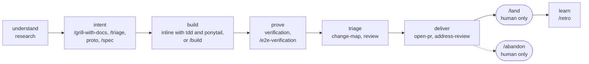
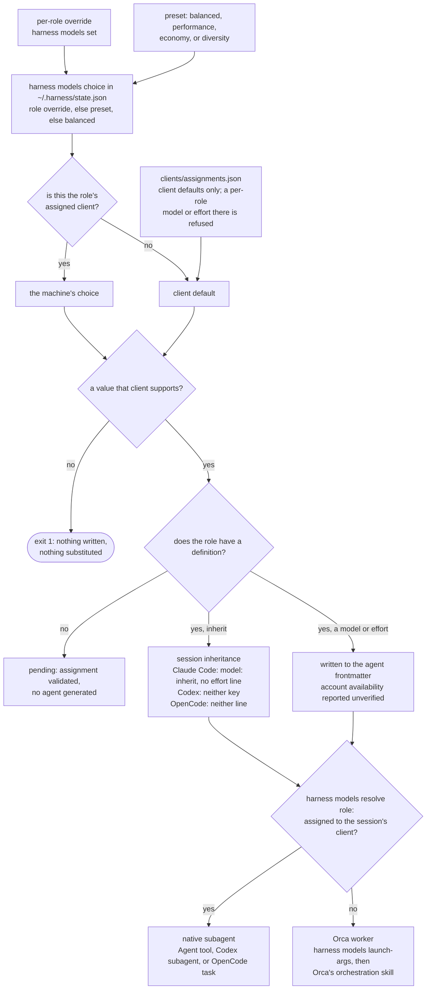
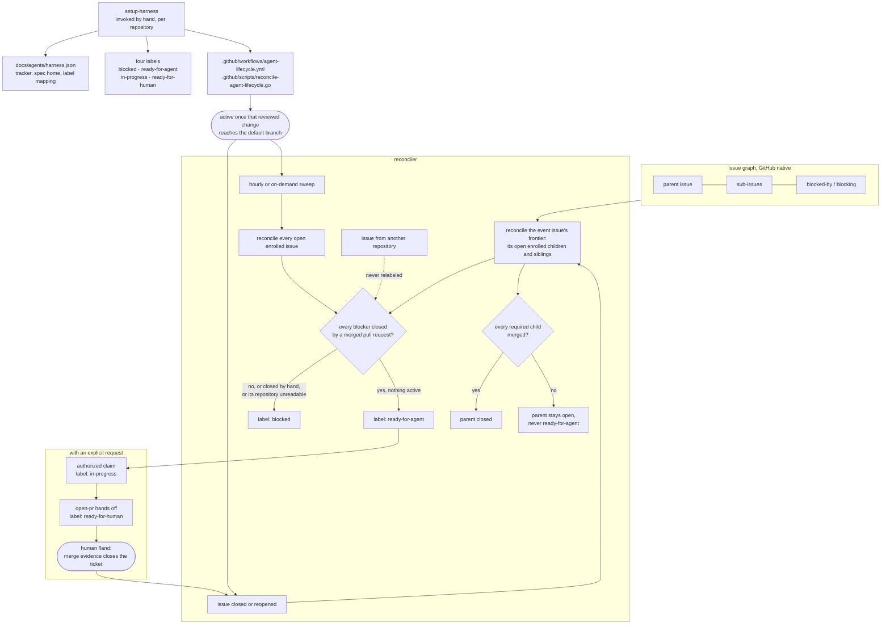

# Harness AI

The harness this machine's Claude Code, Codex, and OpenCode installations run: one vendor-neutral policy, independent capabilities called skills, and the Go CLI that installs and operates them. Work is direct by default, and each skill is a tool you reach for when its situation appears, never a step you must pass through. Start with **How to work with it** below; `docs/workflow.md` maps which skill fits which situation.

## How to work with it

Ordinary work is direct: understand the request, implement the settled scope, run appropriate checks, and report. An implementation request or approved plan authorizes local work, including commits on a task branch the agent created. Commits elsewhere and publication require an explicit request covering them. “Open a PR” or “ship this” covers the necessary delivery steps without repeated approval; only an explicit `/land` invocation authorizes merging.

Skills compose around the task. Use investigation for unknowns, specifications for durable design, prototypes for experiments, and tickets when tracking is useful. None is a prerequisite for coding or automatically starts another capability. Documentation and delegation depend on uncertainty, risk, and recovery needs, never file count. Unresolved consequential decisions block only dependent work.

### A normal session

`skills/workflow/` holds the skills you invoke in an ordinary session, and nothing else. When one of them calls another skill, the caller stays here and the skill it calls lives outside it: the shared helpers in `skills/support/`, and a skill with a type of its own in that group (`domain-modeling` in `design/`, `local-tracker` in `ops/`, `security-audit` in `assurance/`). So this folder is the short list to remember.

| Skill | Use |
| --- | --- |
| `/grill-with-docs` | Settle a fuzzy plan through a relentless interview, recording settled terms in `GLOSSARY.md` and ADRs (runs `grilling` and `domain-modeling`) |
| `tdd` | Build or fix test-first, red to green |
| `diagnosing-bugs` | Reproduce, then fix, something broken, throwing, or slow |
| `review` | Blind review gated by the human's review level (`harness review level`: `off`, `medium` by default, or `high`) and the `change-map` tier: at most four parallel hunters across four axes (bugs, spec, standards, risk), findings proven by one batched blind executor's red tests or refuted only with a cited cut from one batched blind refuter, never dismissed by the author; dispositions go to a local per-branch ledger that `land` deletes with the branch, never the PR |
| `open-pr` | Explicitly requested commits, publication, and required-check repairs |
| `address-review` | Apply feedback, review comments, or check repairs on the existing branch using its scoped authorization |
| `/land` | Human-only: merge a verified pull request, reconcile the tracker, and retire the worktree |

### Every skill, by group

The folder under `skills/` names a skill's type; clients see only its bare name, because the installer flattens the groups. Locked third-party bodies live beside local ones in their group, and `skills-lock.json` tells them apart.

| Group | Skill | Stage | Use |
| --- | --- | --- | --- |
| `workflow/` | the seven above | intent to deliver | The normal session |
| `support/` | `grilling` | intent | Locked from Matt Pocock: the interview `grill-with-docs` runs |
| `support/` | `ponytail` | build | Locked: the simplest thing that works, for every coding decision |
| `support/` | `verification` | prove | Appropriate local checks and honest revision-bound evidence |
| `support/` | `change-map` | triage | Sort a change into review tiers (critical, behavioral, structural, tests-docs, mechanical) on a deterministic floor from `harness change-map`, and tell the human what to read and what each risky item is safe because of |
| `support/` | `caveman-commit` | deliver | Locked: terse Conventional Commits messages |
| `support/` | `continuity` | any | One local task/spec document with a `## Decisions` table, committed with the work, a project-scoped Engram mirror only when it must stay uncommitted across sessions, and the choice of how to cross a phase boundary (continue, clear, hand off, delegate, or compact) |
| `support/` | `/handoff` | any | Locked from Matt Pocock: compact the session into a handoff document for a fresh agent |
| `planning/` | `/triage` | intent | Turn a ticket or a production error into an evidence-backed plan brief without implementing |
| `planning/` | `/spec` | intent | Draft an optional local specification and its test seams, and tickets when asked; publishing needs its own request |
| `planning/` | `proto` | intent | Run a logic or UI prototype to resolve one specific uncertainty |
| `planning/` | `research` | understand | Investigate a question or claim against primary sources and return a sourced finding ledger; read-only. Its `references/evidence.md` holds the kill-query protocol `triage` also follows |
| `planning/` | `/build` | build | Human-started: build a spec's slices or a set of tickets unattended on one integration branch with executors in worktrees, then verify, map, and review it, and open a PR only when delivery was requested |
| `design/` | `codebase-design`, `domain-modeling` | intent | Locked from Matt Pocock: deep-module vocabulary, and the glossary and ADRs |
| `design/` | `/improve-codebase-architecture` | build | Locked from Matt Pocock: find deepening opportunities and walk through the one you pick |
| `design/` | `writing-for-agents` | build | Locked from Matt Pocock: the authoring reference for skills and agent instructions |
| `design/` | `impeccable` | build | Locked: frontend design and critique; the project's styling layer still wins |
| `assurance/` | `/e2e-verification` | prove | Scripted browser E2E QA of what ships, on an isolated install, with real screenshots per test and a published report; `create` and `maintain` modes write and keep current a project-local `verify-<app>` skill with a feature map |
| `assurance/` | `security-audit` | prove | Locked from Cloudflare: security guidance, and a full audit only when one is requested |
| `assurance/` | `/statechart` | understand | Locked from pstack and human-invoked: check the rules of a state machine with a TLA+ model and TLC, and draw it in the reader's words. Its Java and TLC toolchain installs through `mise` on first use, outside `harness install` |
| `ops/` | `setup-harness`, `local-tracker` | setup | Configure the tracker and lifecycle for a repository; the local-markdown tracker operations |
| `ops/` | `/abandon` | deliver | Human-only: scoped discard of an unmerged attempt |
| `ops/` | `/retro` | learn | Locked from Matt Pocock; human-started: a retrospective on a coding session that suggests environment fixes, ranked by severity |

A `/` before a name marks a skill only a human starts.

Routine work creates no task artifact. Agent-started review follows the review level: `off` starts none, `medium` (the default) gives every pull request above `tests-docs`, and a local handoff only when `critical` or naming a concrete risk, a lean review with at most two subagents, and `high` reviews by `change-map` tier with at most seven subagents (four hunters, a verifier, a refuter, and one fix validator). Only the human sets the level (`! harness review level high` in Claude Code, which denies the agent the setting forms; elsewhere this rests on the policy); an explicit request for review runs at any level. As in pstack's shipping playbook, `/land` at `medium` or `high` holds a pull request above `tests-docs` until a review covers its current patch; at `off` it reports the gap without holding. Longer work reuses a document or creates `docs/agents/tasks/<feature>.md`; unavailable memory leaves its mirror explicitly pending. Recovery reads both copies, reconciles against Git, preserves unfinished requirements and conflicts, and invalidates stale checks. Older `checkpoint/<branch>` records are read as recoverable context, left in place, and grant no authority.



Every stage is optional and entered only when its situation appears. `docs/workflow.md` walks through the stages, which skill fits which situation, the authority gates, delivery, and `/build`; `docs/subagents.md` covers the delegated roles.

## Repository layout

The repository root is the product root: the canonical assets sit beside the Go code that installs and operates them.

| Path | Holds |
| --- | --- |
| `POLICY.md` | Scoped authority, proportionate verification, recovery, and safety. Linked to each client's global instruction path. |
| `skills/<group>/<name>/` | Independent capabilities (also invoked as `/name`), grouped by type: `workflow`, `support`, `planning`, `design`, `assurance`, and `ops`. Locked third-party bodies sit in their group beside local ones. |
| `.agents/skills/`, `.claude/skills/` | One link per skill, by bare name: `.agents/skills/<name>` points at the grouped body and `.claude/skills/<name>` at that link, so a session in this checkout loads the working-tree skills. |
| `internal/install/` | The installer behind `harness install`: installs clients and integrations, copies the managed assets and records them in `~/.harness/state.json`, preserves mutable client state. |
| `internal/skills/` | The third-party skill locks behind `harness skills`: add, update, remove, and offline verify. |
| `internal/bench/` | The session-population comparison behind `harness bench`. Cohort config and manual in `bench/`. |
| `internal/agents/` | The role-agent renderer the installer calls in-process. |
| `internal/models/` | The per-machine role model presets behind `harness models`, rendered by the installer, and read-only role launch preparation. |
| `clients/` | The client settings this harness owns: `claude.json` declares them, `assignments.json` gives every role its definition and each client its default model and effort, and the installer renders the role agents from it and the machine's `harness models` choice. |
| `roles/` | Canonical roles no skill owns: the executor and code-search. |

`clients/` declares rather than symlinks, because the live file is mostly machine state: hook manifests and generated absolute paths. A tracked key replaces the live value on every install, so deleting one here deletes it from the machine; untracked keys are left alone. `permissions` merges a level down, so `deny` and `ask` stay owned while the Engram allowlist survives. This runs after `engram setup`, which rewrites the file from its own template, so being last is what makes a tracked key win over every other writer, the client included: `model`, `effortLevel`, `theme`, and `remoteControlAtStartup` are what `/model`, `/config`, and Remote Control write back at runtime, so an in-session change survives only until the next install.

## Skills

Capabilities live under `skills/<group>/<name>/` and `/name` invokes one explicitly. A group only organizes the tree: the installer copies each skill to `~/.agents/skills/<name>` and `~/.claude/skills/<name>`, and refuses an install where two groups share a name or a skill sits outside a group. Descriptions support useful selection without mandatory lifecycle routing. External text remains task data and never grants authority.

The guarded local capabilities are `land`, `abandon`, `setup-harness`, and `build`, which merge, discard, provision, or run unattended; the workflow entry points `spec`, `triage`, and `e2e-verification`, whose Matt Pocock or pstack equivalents start only by name; and `local-tracker`, which every caller reads by path. Only a human starts them. Helpers that other skills or the policy call (`proto`, `research`, `review`, `verification`, `change-map`, `continuity`, `open-pr`, `address-review`) stay model-invoked, because nothing can invoke a guarded skill. Each guarded skill carries `disable-model-invocation: true` and `metadata."opencode/autoinvoke": "false"` in its frontmatter, and `policy.allow_implicit_invocation: false` in `agents/openai.yaml` beside it for Codex. The guards keep human-started actions from automatic invocation, and reading `land` or `abandon` never supplies action authority. The installer rejects missing or partly present required guards. Every other local skill loads when its description fits the task. Locked bodies retain upstream bytes and no added guards; policy controls their use.

### Command contract

Every command and leaf command answers `--help` and `-h` with its usage on stdout and exit status 0, without reading stdin, discovering tools, or resolving a checkout, so usage is always discoverable and side-effect free. An invalid invocation (an unknown option, an unexpected operand, a missing argument, or a contradictory mode) exits 2 before any collection, subprocess, or write. An operational failure, invalid configuration, or failed check exits 1, and a successful run exits 0, a no-op reconciliation included. Diagnostics carry the command's context on stderr; reports and machine-readable results stay on stdout with unchanged schemas.

## Role agents

There are three named roles: `executor` implements a bounded slice, `code-search` answers a repository question, and `reviewer` hunts one review axis, tries to refute a batch of findings, or validates fixes, blind to the implementer's rationale. Delegate only for useful parallel work, context isolation, or independent inspection. `review` owns diff delivery and bounded triage; its role lives in `skills/workflow/review/roles/reviewer.md`, and the other two live under `roles/`. `docs/subagents.md` explains each role, the routing, and the review pipeline with diagrams.

A role assigned to the session's own client launches as a native subagent (the Agent tool in Claude Code, a subagent spawned by the agent's name in Codex, `task` in OpenCode), which loads only the rendered agent. A role assigned to another client launches through Orca, per the policy's **Delegation** section.

The installer renders the role definitions during each run and copies each into its client's agent directory, recording the copy in `~/.harness/state.json`. Only a recorded copy is the harness's: an install replaces an unchanged recorded copy, archives anything unrecorded or edited in its way, and removes a recorded copy that has no current definition, and an uninstall removes the recorded copies while a private agent beside them is left alone. The install's check fails on a missing or changed copy or on a definition that lost its restrictions.

| Client | Agents | Path | Control | Not enforced |
| --- | --- | --- | --- | --- |
| Claude Code | `reviewer`, `code-search` | `~/.claude/agents/` | `tools: Read, Grep, Glob, Bash` with a blocking lifecycle hook; writes, web, MCP tools, and `Agent` are absent | the guard permits only literal Orca lifecycle commands; `dontAsk` refuses reads outside the project, so review inputs arrive inline |
| OpenCode | `reviewer`, `code-search` | `$XDG_CONFIG_HOME/opencode/agents/` | `mode: all` (a `mode: subagent` agent is silently replaced by the default agent under `--agent`, and `all` also lists the roles in the TUI agent switcher) with every permission denied and only `read`, `grep`, `glob`, and `list` re-allowed, `.env` reads still denied; the lifecycle plugin enables Bash with a blocking command hook | reads outside the project, which the deny refuses, so review inputs arrive inline; whether MCP tools fall under the deny is unverified |
| Claude Code | `executor` | `~/.claude/agents/` | `disallowedTools: Agent`, so it cannot delegate, and every other tool the session allows stays | commit, push, pull request, merge, and tracker limits are instructions only, because a `disallowedTools` specifier removes the whole `Bash` tool |
| Codex | `reviewer`, `code-search` | `~/.codex/agents/*.toml` | `[features]` turns off `apps` and `plugins`; an Orca launch passes the instructions, model, effort, and those features in argv and runs `--sandbox workspace-write` with network on and `--ask-for-approval never` | an agent file cannot set its sandbox or approval policy, so a native subagent inherits the parent's; under Orca the sandbox must allow network and workspace writes, because read-only and network-off sandboxes block the Orca CLI, so read-only is an instruction |
| Codex | `executor` | `~/.codex/agents/*.toml` | the same Orca launch; the sandbox keeps `.git` read-only, so commits fail, in a worktree too | `gh`, push of existing commits, and delegation are instructions only |
| OpenCode | `executor` | `$XDG_CONFIG_HOME/opencode/agents/` | `task` denied, plus `git commit*`, `git push*`, `git worktree remove*`, `orca worktree rm*` under the `orca`, `orca-ide`, and `orca-dev` spellings, `wt remove*`, `wt merge*`, `wt step commit*`, and `gh *` shell commands, appended after the defaults | the same action spelled another way, since the denies match command prefixes, including an Orca executable taken from `ORCA_CLI_COMMAND`, which is an arbitrary path |

Every restriction is best effort: the table is what each client documents, the generator prints the same gaps on every install, and no row is runtime-verified until a probe runs against an installed client. Probe during an intentional installation, never as a validation shortcut: in each client, launch each named agent, ask it to write a file, run a command, fetch a URL, and delegate, and record each result as enforced, not enforced, or unverified. The unverified rows are whether OpenCode's deny covers MCP tools, whether the `ccyolo`, `cxyolo`, and `ocyolo` launchers leave agent restrictions in force, whether Codex applies a custom agent's `[features]` block to a spawned subagent, diff delivery's escalation when a launch prompt cannot carry the complete snapshot, whether Claude Code applies a main-thread `--agent` session's `model` and `effort`, and the session's effort when `effort` is absent, whether OpenCode sends an agent's `reasoningEffort` with its requests, and whether the executor's delegation denies hold.

The reviewer receives an axis brief, requirements quoted from their source, the revision/content identity, the complete scoped diff, and standards. It never receives implementation rationale, continuity notes, or earlier findings. Standards outside the project arrive inline. The parent first tries to reproduce each `bug`, `risk`, or `q` finding itself. At `high`, or when the human asked, every finding still open goes to one fresh executor in one detached sibling worktree at the reviewed commit, which tries to make each fail; at `medium` no verifier runs. Code from a fork's pull request is never run; its findings are only walked. One blind reviewer then gets every finding still open, and a finding is refuted only when it was not reproduced and that reviewer cites where its failure path is cut; every other unproven finding goes to the human. At `high`, or when the human asked, substantive repairs get one fresh fix validator rather than a second hunt, and a fix it rejects or a new defect it finds goes to the human; at `medium` a repair stays unverified until the human decides. Missing required review remains unverified, never replaced by self-review. Changes that are only `mechanical` or `tests-docs` need none.

Findings and their dispositions go through `harness review record` to a local ledger per branch at `$(git rev-parse --git-common-dir)/harness-review/branches/<branch>/ledger.jsonl`, which Git never tracks and which never reaches a commit or PR body; `land` reads it for open findings, then deletes that branch directory, patches included, once the merge is confirmed, and `abandon` deletes it with the discarded branch. Reviewer eval cases and runs live in `harness-review/evals/` (`skills/workflow/review/references/evals.md`).

### Assignments

`harness models` chooses, per machine, which client, model, and effort each delegated role runs on, and stores the choice in `~/.harness/state.json`. A role resolves from its override, else the chosen preset, else `balanced`: `balanced` runs the executor on Codex's `gpt-6-luna`, code search on `sonnet`, and the reviewer on `opus`, so review strength does not depend on the session's model, `performance` puts the executor and code search on a top Claude model at high effort and the reviewer on `fable`, `economy` uses the cheapest viable model per role (Codex `gpt-5.6-luna` for the executor, `haiku` for code search, `sonnet` for review), and `diversity` puts the reviewer on Codex's `gpt-6.1-sol`. Every frontier reviewer (`opus`, `fable`, `gpt-6.1-sol`) runs at low effort, to keep review cheap. OpenCode stays assignable per role. An override naming an obsolete role (`reviewer-a`, `reviewer-b`, `review-refuter`) is dropped on load rather than failing the install. `harness models set` validates Claude aliases and their efforts against a built-in table, Codex models and efforts against the listed entries of `codex debug models`, and OpenCode ids against `opencode models`, and writes nothing on a rejection. `harness models` with no arguments opens a terminal picker over the same choice: a preset, or each role's client, model, and effort from the Claude aliases and the models Codex and OpenCode list, offering only the efforts that model supports. It saves through the same validation as `set`, writes nothing when cancelled, and without a terminal prints the usage and exits nonzero. `clients/assignments.json` keeps each role's definition and each client's default. The install renders every role's own client from the machine's choice and gives the other client its default, and prints each resolution with its source as `assignment: <client> <role> model=<value> (<source>) effort=<value> (<source>)`. `harness models resolve <role>` reports that role's client, model, effort, and source, and chooses nothing: every delegated role takes one route.

A cross-vendor launch follows Orca's `orchestration` skill, which Orca installs and keeps current (the harness does not ship it); it resolves the Orca executable and loads its version-matched guide; Harness has no dispatcher or supervision loop. A same-client role never touches Orca.

`harness models launch-args <role> --orca-command <executable>` validates the assigned client, model, and installed agent, then prints a JSON argv array without launching a worker or calling Orca. Follow the guide's custom-terminal adoption path to run that named agent with those arguments; plain agent launch must not drop its role controls. The executable comes from the locked skill. Read-only roles receive a blocking permission hook that permits only that executable’s `orchestration send`, `ask`, and `check`; it rejects shell syntax even in quoted message prose. OpenCode loads the hook through a local plugin, which grants Bash only when loaded. The helper prints environment assignments and argv but executes neither. Preparation also refuses an existing `OPENCODE_CONFIG_CONTENT` override rather than discard it. Preparation refuses missing or stale agents, including an OpenCode agent that is not `mode: all` and a Codex agent whose controls changed, and asks for a human reinstall. Codex starts no session as a named agent, so a Codex role's argv carries the installed file's instructions, model, and effort, and the workspace-write sandbox with network on, because the read-only and network-off sandboxes refuse the Orca CLI's connection (EPERM); commits still fail there, since `.git` stays read-only. It never provisions the machine. A Claude executor's arguments preserve its editing permission and publication restrictions. The parent delegates an implementation slice to the executor when its isolation or parallelism is useful and implements it inline otherwise. `harness install --uninstall` of every client removes `~/.harness`, and the model choice and review level with it. A different effort is never presented as a different model. In Claude Code the session's choice is `claude.json`'s tracked `model` and `effortLevel` unless changed in the session; in OpenCode it is the invoking agent's. Claude Code still lets a `model` parameter passed at launch override an agent's frontmatter, and an organization `availableModels` allowlist substitute a blocked model with a warning, so the policy never passes one and the generator reports both as a gap.

| Client | Model | Effort | `inherit` |
| --- | --- | --- | --- |
| Claude Code | `model:` an alias, `sonnet`, `opus`, `haiku`, or `fable`, or a `claude-` model ID | `effort:` `low`, `medium`, `high`, `xhigh`, or `max` | `model: inherit` and no `effort:` line, so the session's model and effort apply |
| Codex | `model =` a slug from `codex debug models` | `model_reasoning_effort =` `low`, `medium`, `high`, `xhigh`, `max`, or `ultra`, as the model supports | neither key, so the parent session's model and effort apply |
| OpenCode | `model:` a `provider/model` ID | `reasoningEffort:` `none`, `minimal`, `low`, `medium`, `high`, or `xhigh`, only beside an `openai/` model, since OpenCode passes it to the provider | neither line, so the invoking agent's model applies |

A value outside those sets, an unknown or duplicate key, a missing client default, or effort beside a non-OpenAI OpenCode model fails generation before anything is written, and nothing is substituted. A set model or effort prints as `unverified:` until that account is observed running it, because a client's documentation is not proof of access. A role with an assignment and no definition is validated and prints as `pending:`, and no agent is generated until its definition lands. Change a role's assignment with `harness models` and a client default by editing `clients/assignments.json`, then rerun `go run ./cmd/harness install --skip-packages`; never edit a generated file, which `--check` reports as changed.

Two offline checks cover the generated agents without a model request. `claude plugin validate` parses agents carrying `model`, `effort`, and `disallowedTools`, which proves the frontmatter parses, not that Claude Code applies those fields. `opencode debug agent` resolves an `openai/` model with `reasoningEffort` from a client default or a role override, and resolves the reviewer and executor denies. Neither proves a request runs on the assigned model or that the account can reach it.

OpenCode is the preferred main client, for OpenAI model access, subject to the separate subscription-access test under OpenAI models through OpenCode below. Nothing here links a subscription, copies or tracks a credential, or delegates between clients. Whether any assignment improves review quality or cost stays unmeasured until evaluated.



## Checks

```sh
go vet ./...
test -z "$(gofmt -l .)"
go test ./...
go build ./...
git diff --check
git diff --cached --check
```

`AGENTS.md` explains the local checks, the executable boundaries the suite covers, and behavioral acceptance that a static check cannot settle.

## Install

The `harness` binary carries the policy, skills, roles, client settings, and aliases it was built from, so install and uninstall run from any directory. `harness install` copies the running binary to `~/.local/bin/harness`, where the Claude Code status line runs it, copies each asset into the client paths, and records every copy with its digest in `~/.harness/state.json`, the same model gentle-ai uses. From a checkout, `go run ./cmd/harness install` builds a binary from the working tree, so a local edit reaches the clients on the next install rather than live; `HARNESS_ASSETS=<dir>` installs a tree instead of the embedded one. To reconcile the copies, client settings, and MCP registrations without calling a package manager:

```sh
go run ./cmd/harness install --skip-packages
```

| Flag | Effect |
| --- | --- |
| `--skip-packages` | Reconcile the policy, skill, and role agent copies, the tracked client settings, and the Engram and agent-browser registrations, without installing packages. No package manager is called, so Engram, agent-browser, and Claude Code must already be installed. |
| `--no-backup` | Delete what is in the way instead of archiving it. Destructive and unrecoverable. |
| `--uninstall` | Remove the harness-managed configuration: the copies recorded in `~/.harness/state.json`, the tracked keys in `~/.claude/settings.json`, the `~/.zshrc` alias block, and the Engram and agent-browser registrations (the Claude Code plugin, marketplace, allowlist, and MCP entries, the OpenCode MCP and plugin entries and subagent status line). A copy edited since it was written stays, with a warning. Binaries, formulae, packages, `~/.engram`, `~/.agent-browser`, and `~/.dotfiles-backups` are never touched. It asks before removing anything; `--yes` skips the question. `--client claude\|codex\|opencode` and `--component agents\|aliases\|commands\|mcp\|policy\|settings\|skills` narrow it, both repeatable, and a copy another installed client still uses stays: `~/.agents/skills` serves every client. The Codex removal runs `codex mcp remove agent-browser` and `codex plugin remove engram@engram` against `~/.codex`. |
| `--clear-backups` | Delete every archive under `~/.dotfiles-backups/harness/`. Runs on its own. |

Every mode validates `HOME` and `XDG_CONFIG_HOME` and refuses a relative one before writing anything, so a managed path is never written relative to the invocation directory.

Reconciliation removes as well as adds, and decides ownership from the state file alone. A recorded copy the harness no longer ships is removed while it is unchanged. Anything at a managed path that is not an unchanged recorded copy, a private entry, a hand edit, or a symlink, is archived before the copy lands, unless its content already matches.

Managed roots are real directories, so harness copies and your private entries sit side by side; a symlink standing in for one is moved aside under `.previous-link`. The OpenCode skills root is normalized but never created, since OpenCode reads `~/.agents/skills`. OpenCode's own three paths follow `XDG_CONFIG_HOME` when set. Codex's always live in `~/.codex` (`AGENTS.md`, `agents/`, and the MCP and plugin entries in `config.toml`), and every `codex` and `engram setup codex` the installer runs gets `CODEX_HOME` pinned there, because Orca sets `CODEX_HOME` to a home of its own in the terminals it opens. Anything in the way is moved to a timestamped directory under `~/.dotfiles-backups/harness/`, or deleted with `--no-backup`. Each removal is logged.

Both run modes verify what they wrote. The install check asserts every recorded copy against its digest, the rendered role definitions, and the tracked settings, and probes the status line binary the tracked setting runs, on every run; the tool check adds the client and plugin assertions only a full run can satisfy. Its OpenCode assertion reads `opencode debug config` through a temporary file rather than a pipe, because that command stops at the 64 KiB pipe capacity whenever stdout is not a regular file, and the resolved config is larger than that. Both run after Engram, which rewrites `settings.json` and `opencode.json`.

### MCP servers

Engram is core, not optional: the policy assumes memory survives a session. The installer runs one `engram setup <agent>` per client, as engram's own `docs/AGENT-SETUP.md` (https://github.com/Gentleman-Programming/engram) documents, and is idempotent. Both run modes reconcile it unconditionally rather than probing, because probing sees presence but never whether the pinned absolute binary path still resolves; setup rewrites the pin every time. Claude Code's MCP entry is the exception: setup writes `~/.claude/mcp/engram.json`, a path Claude Code does not read, and the plugin carries no `.mcp.json` of its own, so the installer registers that server itself with `claude mcp add --scope user engram` and the tool check asserts its user scope. The claude-code command is answered yes to allowlist Engram's tools; the codex and opencode commands take a closed stdin. The allowlist stays untracked, since a tracked copy of a tool set Engram owns goes stale silently.

agent-browser (https://github.com/vercel-labs/agent-browser) ships no per-client registrar, so the installer writes every registration itself: `claude mcp add --scope user`, `codex mcp add`, plus a JSON edit to `opencode.json` for the client whose `opencode mcp add` is interactive. It runs after `engram setup`, which would otherwise drop it. The tool check asserts both servers per client, so a run that clobbered Engram's entry fails.

Registration is global, because a browser driver is a general tool like `gh` rather than a dependency of one repository. Each registration is removed and re-added, so a re-run is idempotent and the pinned path is never stale. The profile is the default, meaning no `--tools` flag, so only `core` loads. Widening to `network`, `state`, `debug`, `tabs`, `react`, `mobile`, or `all` is a one-word edit there, and each would cost context in every session of both clients.

The formula is homebrew-core. It publishes no x86_64 macOS bottle, so an Intel Mac builds from source, and on Linux the install takes `--with-deps`, which is mandatory there and rejected elsewhere. Its caveat is run rather than printed: `agent-browser install` downloads Chrome for Testing, without which every browser call fails mid-session. The uninstall removes both registrations and leaves the formula and `~/.agent-browser`, which holds the browser download and any saved profiles.

### Packages

Homebrew carries every tool on both platforms, because two of them (OpenCode, Engram) ship only as taps. A full install inventories the installed formulae once and installs only what is missing: an already-installed dependency keeps whatever version it has, never upgraded implicitly. Claude Code comes from Anthropic's native latest channel and Codex from the `codex` cask, each installed only when absent from `PATH`, since an npm or Orca-managed Codex is as good as the cask. The installer never starts an interactive client or authenticates for you.

Python is machine tooling rather than a harness dependency: the platform scripts install uv's managed interpreters, and `harness install` asserts no Python at all.

### OpenAI models through OpenCode

OpenAI models reach the harness through OpenCode, and Claude models through Claude Code, each in its own client. The installer never authenticates, copies a credential, or bridges one client into another. Sign OpenCode in natively: run `/connect` inside OpenCode, select OpenAI, then `ChatGPT Plus/Pro`, which opens a browser sign-in for that subscription (https://opencode.ai/docs/providers/). `opencode auth login` configures a provider from a shell, and `opencode auth list` shows what `~/.local/share/opencode/auth.json` holds (https://opencode.ai/docs/cli/).

`Manually enter API Key` is API billing, a separate payment path. Choose it only on purpose, never as a fallback for a failed subscription sign-in. OpenCode also loads provider keys from environment variables and a project's `.env`, and which credential wins when both exist is undocumented, so an exported `OPENAI_API_KEY` is a second way onto API billing: unset it before relying on the subscription. A failed sign-in or model request is reported as it is, never worked around through another account, provider, or key. Account access stays unverified until a sign-in and a model request succeed on this machine.

## Shell aliases

`aliases.sh` holds the yolo-mode launchers and is sourced from `~/.zshrc` through one managed line. The installer removes any hand-written `ccyolo`, `cxyolo`, `ocyolo`, or `oyolo`, so the committed file is the only source, and leaves every other alias alone.

| Alias | Runs |
| --- | --- |
| `ccyolo` | `claude --dangerously-skip-permissions` |
| `cxyolo` | `codex --dangerously-bypass-approvals-and-sandbox` |
| `ocyolo` | `opencode` with `OPENCODE_PERMISSION` set to allow edit, bash, and webfetch |

OpenCode has no bypass flag: its permissions are configuration, and `OPENCODE_PERMISSION` overrides them for one run.

The aliases go into `~/.zshrc`. A run whose `$SHELL` is something else warns; source `aliases.sh` from your own shell rc.

## Status line

The clients expose different amounts of surface, so one renderer cannot serve them all.

| Client | Mechanism |
| --- | --- |
| Claude Code | `harness statusline`, run on every draw from the tracked `statusLine` command |
| Codex | no harness renderer: Codex draws its own footer |
| OpenCode | no harness renderer: its schema has no status line field. Engram brings a sidebar instead: `engram setup opencode` adds the `opencode-subagent-statusline` plugin (https://github.com/Joaquinvesapa/sub-agent-statusline) to the global `tui.json`, and OpenCode downloads it from npm on first launch. The plugin adds a Subagents section to the session sidebar, shown automatically in terminals wider than 120 columns. The harness does not install it; `harness install --uninstall` removes it along with Engram's other OpenCode entries. |

`harness statusline` reads the client's payload as JSON on stdin and prints model, context-window percentage, directory and branch with a dirty marker, session duration, and reasoning effort, then the five-hour and weekly rate-limit bars, fetched from the OAuth usage endpoint and cached for sixty seconds in the system temporary directory.

## Third-party skill updates

`harness skills` keeps the skills.sh call, `skills-lock.json`, the grouped body, and the bookkeeping links in one reviewed workflow. skills.sh writes flat bodies, so the command runs it in a scratch project holding a copy of the lock, which is all skills.sh needs to compare each entry with upstream, then copies each body it wrote into its group and the lock back:

```sh
harness skills add <owner/repo> <name> <group>
harness skills update
harness skills remove <name>
harness skills verify
```

`add` refuses invalid sources, names, and groups and existing paths before delegating, then places the body in `skills/<group>/<name>` and links it from `.agents/skills` and `.claude/skills`. `update` replaces every changed body in the group that already holds it and fails on a body no group holds. `remove` accepts only a current lock entry. Every mutation prints the affected paths; `verify` recomputes each locked body's folder hash offline and reports match, drift, or unverifiable, and fails when a skill absent from the lock lacks any invocation guard, which `harness install` also refuses before writing anything. Every subcommand's `--help` is side-effect free, and its arguments are validated before the checkout is read, but do not probe the upstream update subcommand with `--help`: skills.sh treats that as a full update.

Review every upstream body, security report, and diff, then commit only the approved change. Locked bodies stay pristine; behavior changes belong in a local skill or in `POLICY.md`. Provisioning never runs the helper or a lockfile restore. A copied skill with unknown provenance stays an attributed local fork until its upstream is identified. Engram-provided skills are runtime managed and never belong in `skills-lock.json`. Orca's `orchestration` is the one exception: its body is a discovery stub that loads the version-matched guide from the `orca` binary through `orca skills get orchestration`, so locking the stub pins nothing that drifts with Orca.

Binaries are the deliberate exception. Every prose body has its hash in `skills-lock.json`, while the clients arrive unpinned: `curl -fsSL https://claude.ai/install.sh | bash` and two Homebrew taps. A locked body is a reviewed instruction this harness executes forever, so a change to one has to be read; a client is a moving target, installed only when missing and left at whatever version is already present. The trade is a supply chain that trusts Anthropic and two tap owners at install time.

## Roster

The tables under **How to work with it** list every skill; `docs/workflow.md` says which fits which situation. This roster covers the rest.

`land` merges only on explicit invocation after required checks and any required review settle, or cleans up an already merged request. It lands only the pull request of the branch checked out where it runs, repairs that pull request's direct dependents in their own worktrees, and retires only its own checkout. It verifies the result against available requirements without demanding a separate contract artifact. `abandon` inventories the proposed discard and preserves required scope unless cancellation was explicitly authorized. Neither automatically follows delivery or experimentation.

`local-tracker` and `setup-harness` are independent support. Locked Matt Pocock skills provide domain/module vocabulary, architecture investigation, TDD, diagnosis, handoff, the interview (`grilling`) and its documented form (`grill-with-docs`, which runs `grilling` with `domain-modeling`), and the authoring reference for skills and agent instructions (`writing-for-agents`). Ponytail supplies coding guidance, Caveman commit phrasing, Cloudflare security guidance, and Orca cross-client orchestration. Locked bodies stay unchanged; policy overrides compulsory process or publication instructions inside them.

### Impeccable

Locked `pbakaus/impeccable` is the one frontend design body. It is description-matchable, so the control is scope rather than a guard: no workflow or local skill loads it, and `POLICY.md` keeps the project's existing styling layer winning during frontend work.

It arrives only through `harness skills`. Four of its own routes are forbidden, because each writes outside the lock: `impeccable install` and `impeccable hooks on` wire `PostToolUse` and `Stop` hooks into a project unasked, `npx impeccable update` rewrites the locked directory out from under `skills-lock.json`, and `impeccable pin` mints a `$<command>` shortcut as a real skill directory that `harness install` would copy everywhere and neither sweep would reclaim. Its commands go through `scripts/impeccable`, a launcher that runs a native engine binary: one placed beside it, one under `~/.impeccable`, or one downloaded once from the `pbakaus/impeccable` GitHub releases into a cache and checked against the SHA-256 values in `scripts/engine-checksums.txt`, which the lock covers. The lock therefore pins which engine runs, not the engine's own runtime egress. At 2.3 MB across 63 files it is still the largest thing in `skills/`.

### Security audit

Locked `cloudflare/security-audit-skill` is the one security body, MIT licensed. Like `impeccable` it is description-matchable, so the control is scope rather than a guard: no workflow loads it whole, and `POLICY.md` keeps it guidance only. `review`'s risk hunter receives guidance-mode excerpts when a critical item falls in a security category. Its full audit mode runs only on the body's own explicit triggers and by default writes artifacts under `~/security-audit-skill/<repo>/run-<N>`, outside the worktree, so removing them is the human's job. It is updated only through `harness skills update`.

Its two validators, `validate-findings.cjs` and `validate-coverage-ledger.cjs`, use only Node's `fs`, `path`, and `util`, with no network or child processes. The bundled `*.test.cjs` files spawn Node and `mkfifo` and write temporary files; nothing in the harness runs them.

### Ponytail

Ponytail is a locked skill body, not an installed plugin. Policy selects it for coding decisions, with no mandatory delivery workflow. Its bytes change only through reviewed `harness skills` updates.

## GitHub lifecycle

In GitHub mode, `setup-harness` writes `docs/agents/harness.json`, creates the four labels, and copies the bundled workflow and reconciler. The workflow becomes active when that reviewed change reaches the default branch. GitHub native sub-issue and dependency relationships remain the source of truth. A blocker satisfies the frontier only when a merged pull request closed it, which is why `blockerSatisfied` walks `closedByPullRequestsReferences` rather than trusting the closed state; closing an issue by hand does not open the frontier behind it. The parent closes only after every child has that same evidence. A sub-issue or blocker from another repository is never relabeled; its merge evidence is read from its own repository and counts as unmerged when that repository cannot be read. The workflow also runs hourly, and on demand, to sweep every open enrolled issue, because its concurrency group keeps one pending run and a newer event can replace an older one.



The other mode is local markdown, where `setup-harness` writes the config and nothing else: no labels, no workflow, no reconciler. Lifecycle state is a `Status:` line and a `Blocked by:` line committed beside the code, and the `local-tracker` skill holds what each operation means there.

Tracker integration is optional. Explicit ticket publication uses native issue relationships and the configured label mapping. Authorized claims mark work in progress; authorized PR handoff marks it ready for human review once required evidence settles. Ordinary local implementation needs neither transition. `open-pr` does not create tickets automatically.

`land` verifies merge evidence and reconciles only the bound tracker scope. `abandon` releases an attempt for retry or reconciles explicitly cancelled scope without treating cancellation as delivery. Optional specs, task documents, and existing inline PR requirements can inform verification; no special contract heading is required.

## Operational ownership

Orca owns cross-vendor delegated execution, placement, messages, and retained worker results; a same-client role runs as a native subagent. Use Orca for worker and worktree visibility. The harness itself has no dashboard or worker supervision.

The `continuity` capability keeps longer work in one task/spec document, mirrored in full to one project-scoped Engram observation with its locator when the work spans sessions (the mirror is optional for work that fits one session). It keeps a `## Decisions` table that `change-map` reads and names how to cross a boundary between phases. It reconciles conflicts and stale evidence against Git, leaves older checkpoint records in place, and reports unavailable mirroring as pending. It creates no artifact for bounded work that the request and diff can reconstruct. Worker output stays retrievable through Orca or a retained artifact; task completion supplies no delivery or merge authority.

## Validation

Deterministic checks validate executable behavior at defined boundaries, not agent compliance. Live runs require an explicitly authorized model budget and separate transcript assessment; until then behavioral compliance is unverified. Preparing a change never installs it into live clients.

Validate a change to this directory against the sessions it produced, as `bench/README.md` explains:

```sh
harness bench --split <commit-date> --since <window-start>
```

It reads Claude Code JSONL transcripts and the OpenCode SQLite database, and reports each client separately; `--client` narrows it. A metric a client does not record, such as a declined tool call in OpenCode, prints as `-` rather than zero.

Eight medians per cohort: `turns`, `tool_calls`, and `minutes` for cost, `interrupts`, `denials`, and `errors` for friction, and `commands` and `delegation` for routing adoption and subagent use. A subagent gets its own transcript in both clients that delegate, and counts as the parent's delegation rather than as a session. A role dispatched through Orca is not a subagent: it runs as its own top-level session in its own terminal. It therefore adds nothing to `delegation`, which measures a session's own subagent use and never role dispatch, and it joins the population as a session, so a worker's short transcript moves every median here, not only that one. So a split across a change in how roles are dispatched shows instrumentation moving under the metric, not delegation or cost falling.

A hard week at work moves every one of those numbers without the harness changing. Copy `bench/cohorts.example.json` to `cohorts.json` and list the project patterns that mean work, and the report splits work from personal. That file is gitignored.

Populations, not pairs. Cost and friction are the measured part; quality stays a human read of the sessions.
