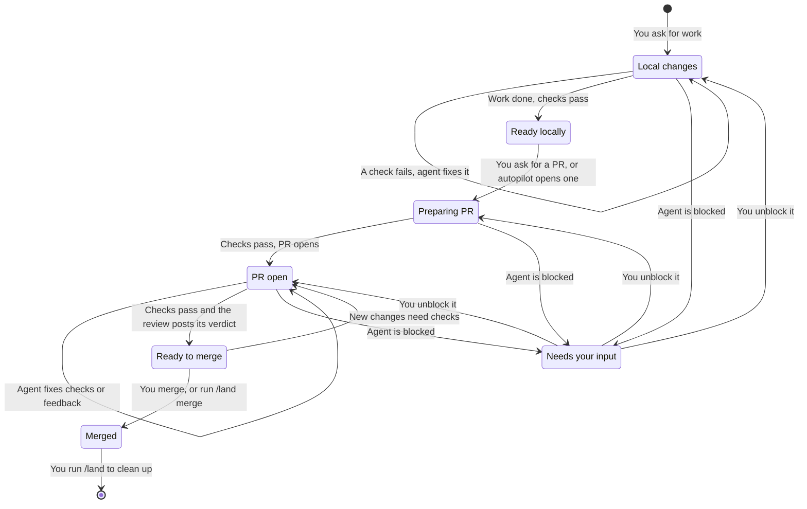

<div align="center">

# Harness AI

**One shared setup for three coding agents: Claude Code, Codex, and OpenCode.**

[](go.mod)
[](https://pkg.go.dev/github.com/jvillegasd/harness)
[](#quick-start)
[](https://github.com/jvillegasd/harness/commits/main)

[](https://www.anthropic.com/claude-code)
[](https://github.com/openai/codex)
[](https://opencode.ai)

[Quick start](#quick-start) · [Workflow guide](docs/workflow.md) · [Review](docs/review.md) · [CLI reference](docs/cli.md) · [Contributing](#contribute-to-the-harness)

</div>

---

The harness installs the same rules, skills, and helper roles into all three clients, so every agent works the same way on your machine.

## Highlights

- **One install, three clients.** `harness install` provisions the floor rules, skills, roles, MCP servers, and client settings for Claude Code, Codex, and OpenCode, and never overwrites a file you edited.
- **You stay in control.** Agents work on their own task branches. Nothing is pushed, published, merged, or discarded until you ask.
- **Proven review.** Independent reviewers hunt for defects without the author's reasoning, only problems a run proves are reported, and each review posts one `PASS`, `PASS+NOTES`, or `FAIL` verdict on its pull request.
- **Guarded landing.** `/land` merges only on your request and only when the checks, the review verdict, the run-as-user verdict, and the forge gates allow it, then cleans up branches and worktrees without losing work.
- **Deterministic steps.** Repeatable workflow steps are `harness` commands with tests, not prose an agent has to interpret.

## Contents

- [How it feels](#how-it-feels)
- [Quick start](#quick-start)
- [Ask for what you need](#ask-for-what-you-need)
- [What the agent does on its own, and what waits for you](#what-the-agent-does-on-its-own-and-what-waits-for-you)
- [Review](#review)
- [jvillegasd-mode](#jvillegasd-mode)
- [Models](#models)
- [Shell aliases](#shell-aliases)
- [Other things the installer sets up](#other-things-the-installer-sets-up)
- [Install only part of it](#install-only-part-of-it)
- [Keep tools up to date](#keep-tools-up-to-date)
- [Uninstall](#uninstall)
- [Manage skills](#manage-skills)
- [Commands the skills run](#commands-the-skills-run)
- [Contribute to the harness](#contribute-to-the-harness)
- [Guides](#guides)
- [Acknowledgments](#acknowledgments)

## How it feels

You keep working the way you already do. Ask the agent for something in plain words, and it reads the code, makes the change on a task branch, runs the checks, and tells you what it did. Skills help with specific jobs, but you never have to run them in any order. When you want a stricter, step-by-step run, start the task with `/jvillegasd-mode`.

## Quick start

You need macOS or Linux, zsh or bash, Homebrew, and Go 1.26 or newer.

1. From this checkout, run the installer:

   ```sh
   go run ./cmd/harness install
   ```

2. Sign in to each client (Claude Code, Codex, OpenCode) yourself. The installer does not log in for you.
3. Open a client in any repository and ask for what you need.

The installer adds any missing tools, copies the rules, skills, and roles into each client, sets up the Engram memory server and agent-browser, and adds a few shell aliases. A tool you already have on your `PATH` is left exactly as it is.

After the first install, the `harness` command lives at `~/.local/bin/harness`. The [installation guide](docs/installation.md) explains what happens to files that are already there.

## Ask for what you need

A plain request works the way it always does. For the harness's procedures (planning, building, review, delivery), start the mode; every skill also stays callable by name.

| You want to | Ask for |
| --- | --- |
| Run a task step by step, with every step visible | `/jvillegasd-mode <task>` |
| Leave a task running while you step away | `/jvillegasd-mode autopilot, I'm stepping away: <goal>` |
| Think an unclear idea through, recording ADRs and glossary terms | `/grill-with-docs` |
| Turn a settled plan into an epic with sliced tickets | `/jvillegasd-mode plan <idea>` |
| Build one ticket, or an epic's slices | `/jvillegasd-mode build <ticket or epic>` |
| Get a review of your changes | `/jvillegasd-mode review` |
| Publish the work as a pull request | `/jvillegasd-mode open a PR` |
| Clean up after you merge a PR | `/land`, or `/land merge` to have the agent merge for you; name PRs (`/land merge 19 20`, `/land merge stack 23`) to land ones not checked out here |
| Clear out old worktrees and branches | `/cleanup` |

The [workflow guide](docs/workflow.md) lists every skill and when to reach for it.

## What the agent does on its own, and what waits for you

- **Local work stays local.** The agent edits and commits on its own task branch, but nothing is pushed or published until you ask.
- **You merge.** Every pull request ends with a readiness report. You read it and merge. The agent merges only when you run `/land merge`.
- **Nothing is thrown away without your say.** The agent discards work only when you name it. If the scope is unclear, it asks.
- **It stops and asks** when it needs a decision only you can make, or when a required check cannot run.

This diagram shows the full path from a request to a merged change:



**"Ready locally" is a finished result.** If you do not want a pull request, stop there. You can ask for one with the original task or at any time later. When work is waiting on you, it picks up again at the stage that was blocked. The [workflow guide](docs/workflow.md#local-work-and-delivery) describes each stage.

## Review

Before work reaches you, other agents can review it without hearing the author's reasoning, so they judge the code and not the explanation. Only problems that a test or script actually proved reach you. Everything else is dropped and counted.

You choose how much review happens on its own:

```sh
harness review level medium    # off, medium (the default), or high
```

- **`off`:** no automatic review.
- **`medium`:** one independent reviewer for every PR beyond docs or tests, and for local changes with a concrete risk.
- **`high`:** adds one or two specialist reviewers where the change needs them.

Asking for a review always runs one at your level. [How review works](docs/review.md) walks through a review from start to finish, and each review posts its verdict as one comment on the pull request. The [`harness review` commands](docs/cli.md#review-commands) describe that comment.

## jvillegasd-mode

`/jvillegasd-mode <task>` makes the agent follow a fixed playbook instead of choosing skills on its own. The agent picks the playbook that fits (bug fix, feature, investigation, refactor, performance, hillclimb, forensics, design, skill authoring, you-got-this for large or unmatched work, or one of the existing skills), then copies every step into its todo list. A step it skips stays in the list as `skip: <reason>`, so you can see what was left out and why.

For a code change, jvillegasd-mode always ends with a change summary (`change-map`) and a review at your level. A plan request writes an epic with sliced tickets and asks whether to build it. Merging still goes through you or `/land`.

jvillegasd-mode lasts for the whole conversation. Say "new task" to start another playbook, or "stop jvillegasd-mode" to end it. Only you can start it.

### Autopilot

Add "autopilot" or "I'm stepping away", plus a goal:

```text
/jvillegasd-mode autopilot, max 3h: make the export job finish under a minute
```

The agent writes down a pass or fail definition of done (or proposes one), then works without checking in until the goal is met or time runs out. The default time limit is 2 hours.

On autopilot the agent **may** commit, push, and open pull requests, including separate PRs for problems it finds along the way. It **never** merges, writes to the issue tracker, or messages anyone. When it hits a decision only you could make, it takes the simplest safe option and lists it at the top of its report, with what to tell it if you want something else. Without a goal, autopilot does not start.

## Models

Each helper role (such as the executor or the reviewer) runs at a tier, the kind of work its model is meant for. You choose which client and model serve each tier, and which tier and effort each role runs at.

| Tier | Work | Claude | Codex |
| --- | --- | --- | --- |
| `heavy` | System design, architecture | Opus (default) | newest `-astra` |
| `high` | Defects, engineering, analysis (and design when no heavy model is listed) | Opus | newest `-sol` |
| `standard` | Scoped work with tests | Sonnet | newest `-terra` |
| `fast` | Classification, gathering data in volume, boilerplate | Haiku | newest `-luna` |

```sh
harness models                                        # pick interactively
harness models show                                   # see each tier and role

# Tiers: which client and model serve each kind of work
harness models tier preset claude                     # balanced (default), claude, or codex serves the tiers
harness models tier set high --client codex           # serve a tier from another client
harness models tier set heavy --client claude --model fable  # run a tier on another model
harness models tier reset                             # back to the balanced preset

# Roles: which tier, client, and effort each role runs at
harness models role set reviewer --tier heavy --effort high  # move a role to another tier
harness models role reset reviewer                    # the role back to its default
```

On Claude, the recommended models for `heavy` are Fable and Opus. It defaults to Opus because Fable is not on every plan; when yours includes Fable, map heavy to it with the `tier set heavy` line above. OpenCode has no tier names, so it serves a tier only with a model you name: `harness models tier set fast --client opencode --model <provider/model>`. Under each tier, `harness models show` and `harness models tier show` list on an `also` line what the other clients run there, so you can see the model a role would get before you move it to one of them with `role set --client`. Each command that saves a choice, and the picker, applies it to the role agents of every client that already has them, so the clients pick it up without a reinstall; `harness install agents` renders them for a client that has none yet. A role assigned to the client you are in runs as a normal subagent. A role assigned to another client runs through T3 Code. The [delegation guide](docs/subagents.md) explains the roles.

## Shell aliases

| Alias | Starts |
| --- | --- |
| `ccyolo` | Claude Code with permission checks turned off |
| `cxyolo` | Codex with approvals and the sandbox turned off |
| `ocyolo` | OpenCode with edit, shell, and web access allowed |

These aliases give the agent broad access to your machine. Use them with care.

The installer loads them from your login shell's startup file:

- **zsh:** `~/.zshrc`
- **bash on Linux:** `~/.bashrc`
- **bash on macOS:** the first of `~/.bash_profile`, `~/.bash_login`, or `~/.profile` that exists, or a new `~/.bash_profile`. A macOS bash login shell reads only the first one it finds.
- **Any other shell, such as fish:** no line is added, and the installer prints a warning that names `~/.harness/aliases.sh` so you can load it yourself.

Uninstall removes the line only from files that carry the harness marker.

## Other things the installer sets up

- **A status line for Claude Code.** Codex keeps its own footer.
- **A compaction hook in every client.** When a long session is compacted, the hook runs `harness resume`, so the agent gets back the branch, its latest commit, and the next step from the task document. Codex runs the hook only after you trust it once in its `/hooks` screen.
- **Tracked client settings.** These are reapplied on every install, so some preferences you changed inside a client can be overwritten.

## Install only part of it

Name the components or clients you want:

```sh
harness install skills agents       # only these components
harness install --client claude     # only Claude Code
```

The components are `clients`, `packages`, `mcps`, `skills`, `agents`, `floor`, `settings`, and `aliases`. `harness update` and `harness uninstall` accept the same names. The [command-line reference](docs/cli.md#components) explains each one.

Editing this repository does not change installed clients. Run an install to apply your edits.

## Keep tools up to date

`harness install` never upgrades a tool you already have. To upgrade, ask for it:

```sh
harness update                         # everything below, in this order
harness update packages                # Node, gh, uv
harness update clients                 # Claude Code, Codex, OpenCode
harness update mcps                    # Engram, agent-browser, and their registrations
harness update skills                  # locked upstream skills and the lockfile
harness update clients --client codex  # Codex only
```

The updater uses each tool's own release channel. If it cannot tell how a tool was installed, it tells you to update that tool by hand. The [command-line reference](docs/cli.md#update-installed-tools) covers the details and what happens when an update fails.

## Uninstall

```sh
harness uninstall          # remove the managed config; your tools stay
harness uninstall --all    # also remove the tools the harness installed, then the harness itself
```

Uninstall asks before it removes anything. It keeps any copy you edited, removes only tools it recorded installing, and never deletes a tool's data.

Two options delete things for good:

- `harness install --no-backup` deletes files in the way instead of archiving them.
- `harness uninstall --clear-backups` deletes the archives.

## Manage skills

Skills live in `skills/<group>/<name>/`, grouped by purpose: `orchestration`, `investigation`, `planning`, `building`, `delivery`, `assurance`, `design`, `writing`, and `principles`. The group only organizes this repository. Clients call a skill by its name alone.

Create or move a skill of your own with these commands, which also write the links each client reads:

```sh
harness skills new <name> <group> [--guarded]   # --guarded: callable only by name
harness skills move <name> <group>
```

Skills taken from other projects are locked: `skills-lock.json` records a hash of each one, and you change them only through these commands, never by editing them.

```sh
harness skills add <owner/repo> <name> <group>
harness skills update
harness skills remove <name>
harness skills verify
```

Read the upstream changes before you commit them. An install does not update locked skills. The [command-line reference](docs/cli.md#skill-commands) covers each command.

## Commands the skills run

Many skill steps are `harness` commands rather than written instructions, so they behave the same every time. You can run them yourself to see what an agent saw:

| Command | What it does | Run by |
| --- | --- | --- |
| `harness pr status` | Whether a PR is ready to merge, and its first blocker | `open-pr`, `address-review` |
| `harness land check`, `merge`, `sync`, `finish`, `repair` | Whether a PR can land, the merge itself, then the cleanup after it | `/land` |
| `harness review target`, `verdict` | What a review reads, and the one verdict comment a review posts on its PR | `review`, `open-pr` |
| `harness worktree audit`, `retire` | List worktrees and remove one without losing work | `/land`, `/cleanup`, `build` |
| `harness tickets check`, `frontier`, `publish` | Validate slice drafts, pick the ready ones, and publish them to GitHub | `epic`, `build` |
| `harness attempts add`, `list` | The log of measured attempts | `/jvillegasd-mode`'s hillclimb playbook |

The [command-line reference](docs/cli.md) explains each one. `harness <command> --help` lists the flags.

## Contribute to the harness

| Path | What it holds |
| --- | --- |
| `FLOOR.md` | The rules every client follows on every turn |
| `GLOSSARY.md`, `docs/adr/` | The harness's terms, and the decisions behind its design |
| `cmd/harness/`, `internal/` | The `harness` command and its code |
| `skills/` | The skills, grouped by purpose |
| `clients/`, `roles/` | Client settings and role definitions |
| `docs/agents/` | Tracker settings, task documents (`tasks/`), and ticket drafts (`tickets/`) |

Run every check before you hand off a change:

```sh
go vet ./...
test -z "$(gofmt -l .)"
go test ./...
go build ./...
git diff --check
git diff --cached --check
```

The tests check the code's behavior, not whether an agent follows the written rules.

## Guides

These pages are written for people. Agents keep them accurate but never take instructions from them. What agents follow lives in `FLOOR.md`, the skills, and each repository's `AGENTS.md`.

| Guide | Read it to |
| --- | --- |
| [Working with the harness](docs/workflow.md) | Pick a skill, understand jvillegasd-mode, and follow work from request to merge |
| [How review works](docs/review.md) | See what reviewers do and which findings reach you |
| [Delegation](docs/subagents.md) | Learn the helper roles and their limits |
| [Installation and your files](docs/installation.md) | See how install and uninstall treat files already on your machine |
| [Command-line reference](docs/cli.md) | Look up `harness` command behavior beyond `--help` |

## Acknowledgments

This harness takes inspiration from these projects:

- [Matt Pocock's skills](https://github.com/mattpocock/skills), the source of several locked skills, among them `tdd`, `diagnosing-bugs`, `grill-with-docs`, and `domain-modeling`.
- [Gentle AI](https://github.com/Gentleman-Programming/gentle-ai), which configures several coding agents from one setup, as this installer does.
- [pstack](https://github.com/backnotprop/pstack), the source of the principle skills and the verification skills, and the model for jvillegasd-mode's playbooks and autopilot.
