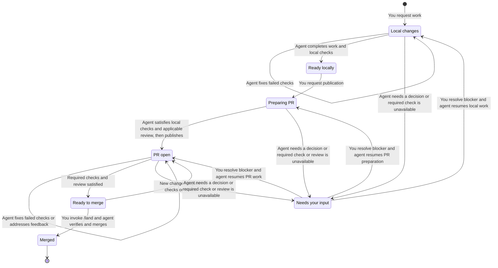

# Harness AI

Shared policy, skills, and tools for Claude Code, Codex, and OpenCode.

Ask the agent to do the work. It inspects the code, makes changes on a task branch, runs checks, and reports the result. Skills help with specific jobs; they are not a required sequence.

## Install

Requires macOS or Linux, zsh, Homebrew, and Go 1.26 or newer.

```sh
go run ./cmd/harness install
```

The installer installs missing tools, copies the policy, skills, and role agents into the clients, configures Engram and agent-browser, and adds shell aliases. Sign in to each client yourself; installation does not authenticate accounts.

To apply checkout changes without installing packages:

```sh
go run ./cmd/harness install --skip-packages
```

This still changes live client settings and MCP registrations. Engram, agent-browser, and Claude Code must already be installed. Editing this repository alone does not update installed clients.

The installed binary is `~/.local/bin/harness`. It carries the assets it was built from. Managed files are recorded in `~/.harness/state.json`; collisions are archived under `~/.dotfiles-backups/harness/`. Private entries are left alone. Tracked settings are reapplied on installation, so some in-app preferences may be overwritten.

```sh
harness install --uninstall
```

Uninstall asks first, preserves edited copies, and leaves installed packages and user data. Use `--help` for client and component filters. `--no-backup` deletes installation collisions; `--clear-backups` deletes archives. Both are destructive.

See [installation and your files](docs/installation.md) for how installation and removal handle existing copies.

## Everyday use

| Need | Ask for |
| --- | --- |
| Implement a feature, fix, or one ticket with TDD | `/implement <task or ticket>` |
| Fix something broken or slow | Diagnosis and a fix |
| Settle an unclear idea | `/grill-with-docs` |
| Write a specification | `/spec` |
| Build test-first | `tdd` |
| Review changes | `review` |
| Publish the work | “Open a PR” or “ship this” |
| Merge the current PR | `/land` |

Local work stays local until you request publication. Only your explicit `/land` merges a PR. An explicit request naming work to discard authorizes that scope; ambiguity or additional work requires clarification.



**Ready locally is a complete outcome.** Stop there if you do not want a PR. A publication request can come with the original task or later. From **Needs your input**, work resumes at the stage that was blocked. See [the workflow guide](docs/workflow.md#local-work-and-delivery) for details.

Review defaults to `medium`. Set it yourself with `harness review level off|medium|high`. Medium reviews PRs above documentation/test-only changes and local changes with concrete risks. High adds deeper review. An explicit review request works at any level.

Read [the workflow guide](docs/workflow.md) for optional planning, builds, and tracker setup, or [the delegation guide](docs/subagents.md) for worker roles.

## Models and aliases

Use `harness models --help` to inspect presets and per-role assignments. Changing an assignment requires installation to refresh the rendered agents. Roles assigned to the current client run natively; other clients run through Orca.

| Alias | Starts |
| --- | --- |
| `ccyolo` | Claude Code with permission checks bypassed |
| `cxyolo` | Codex with approvals and sandbox bypassed |
| `ocyolo` | OpenCode with edit, shell, and web access allowed |

The installer sources `aliases.sh` from `~/.zshrc`. These launchers grant broad access. Claude Code also gets a harness status line; Codex uses its own footer.

## Maintain skills

Skills live in `skills/<group>/<name>/`; clients invoke them by name. Groups organize the repository, not the workflow.

```sh
harness skills add <owner/repo> <name> <group>
harness skills update
harness skills remove <name>
harness skills verify
```

Review upstream changes before committing. Locked third-party skills change through these commands, never by editing their bodies. `skills-lock.json` records their hashes. Installation does not update them.

## Develop

| Path | Purpose |
| --- | --- |
| `POLICY.md` | Authority and safety rules shared by clients |
| `cmd/harness/`, `internal/` | CLI and implementation |
| `skills/` | Skills, grouped by purpose |
| `clients/`, `roles/` | Client settings and role definitions |
| `docs/agents/` | This repository's tracker configuration |
| `bench/` | Real-session cost and friction measurement |

Run all local checks before handing off a change:

```sh
go vet ./...
test -z "$(gofmt -l .)"
go test ./...
go build ./...
git diff --check
git diff --cached --check
```

[AGENTS.md](AGENTS.md) describes the test boundaries. Tests check executable behavior, not whether an agent follows prose. Live behavioral evaluation needs an explicitly authorized model budget. [Bench](bench/README.md) compares session cost and friction; it does not prove correctness.
