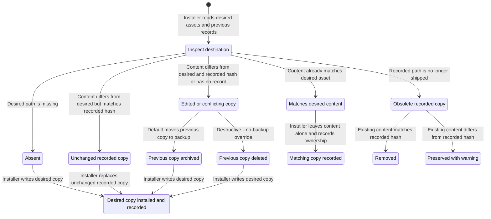
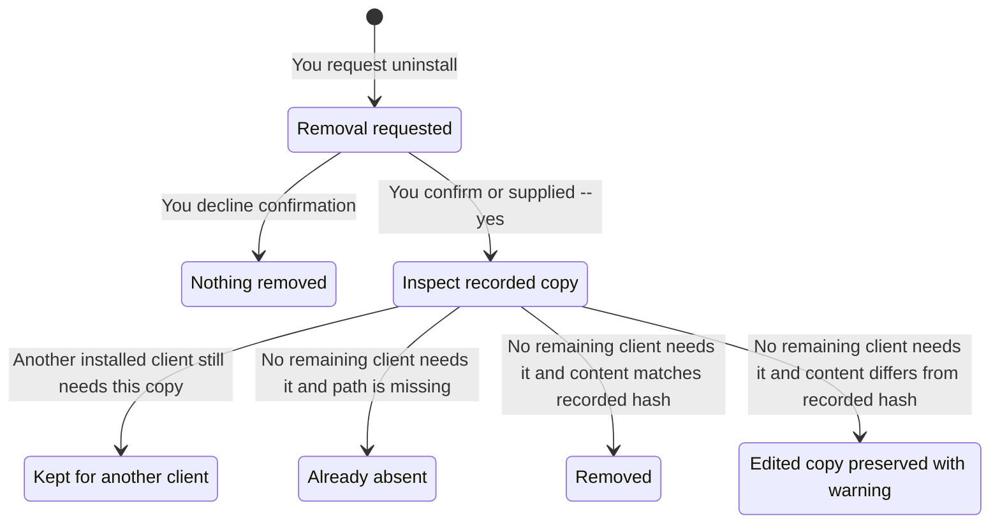

# Installation and your files

This page explains what `harness install` and `harness uninstall` do to files that are already on your machine. The short version: the harness only replaces or removes copies it wrote itself and that you have not changed. Anything else is archived or left alone.

## How the harness tells its files from yours

Each time the installer copies a file into a client (a skill, the floor, or a role definition), it records the file's path and a hash of its content in `~/.harness/state.json`. On the next run it compares what is on disk with that record:

- **Same hash as recorded:** the harness wrote it and you have not touched it, so the harness may replace or remove it.
- **Different hash, or no record:** you edited it, or it was never the harness's. The harness archives it or leaves it alone.

A copy can be a whole directory, so an edit to any file inside it counts as an edit to the copy.

This page covers those copied files. Client settings and MCP registrations follow their own rules, described below. Tools such as `node` or `gh` are covered in the [command-line reference](cli.md#install-and-uninstall).

## Install

Two commands install the same way but from different sources:

- `harness install` installs the files built into the `harness` binary.
- `go run ./cmd/harness install` installs the files in this checkout, including your uncommitted edits.

Both change your live client configuration. To limit a run, name components, such as `harness install skills`. The run then reads, writes, and removes only copies of those components.

For each file, the installer does one of these things:

| What is on disk | What the installer does |
| --- | --- |
| Nothing | Writes the new copy and records it |
| Already the new content | Leaves it and records it |
| The harness's own unchanged copy | Replaces it with the new copy |
| An edited copy, or a file the harness never recorded | Moves it to the backup folder, then writes the new copy |
| A recorded copy the harness no longer ships, unchanged | Removes it |
| A recorded copy the harness no longer ships, edited | Keeps it and prints a warning |

The same flow as a diagram:

A few more details:

- Your own files next to the harness's (for example, a private skill with its own name) are never touched.
- If a folder the harness manages is a symlink, the installer moves the symlink aside before it installs.
- Tracked client settings are reapplied on every install, so some preferences you changed inside a client can be overwritten.

### Backups

Files moved out of the way go to `~/.dotfiles-backups/harness/`. Two options delete instead, and the harness cannot bring the files back:

- `harness install --no-backup` deletes conflicting files instead of archiving them.
- `harness uninstall --clear-backups` deletes the archives.

## Permission rules

The floor's rules about commands and secrets are not only written in `FLOOR.md`. Each client also enforces them in its own way:

| Client | Where the rules go |
| --- | --- |
| Claude Code | Its tracked settings |
| Codex | A rules file of its own, `~/.codex/rules/harness.rules`, copied and recorded like the files above |
| OpenCode | Merged into `opencode.json`, after your own rules |

OpenCode applies the last rule that matches, which is why the harness's rules go after yours. If you set a pattern stricter than the harness's, your setting stays. Uninstall takes out only the harness's rules.

Codex rules can only cover commands. In Codex, the agent keeps secrets unread because its instructions say so, not because a rule blocks it.

## Uninstall

Run `harness uninstall`. It asks you to confirm first. Pass `--yes` to skip the question. Component names and `--client` narrow what it removes.

For each recorded copy:

| Situation | What uninstall does |
| --- | --- |
| Another installed client still uses the copy | Keeps it |
| No client needs it, and it is already gone | Nothing |
| No client needs it, and it is unchanged | Removes it |
| No client needs it, and you edited it | Keeps it and prints a warning |

Uninstall also forgets the edited copies it keeps. After that, the harness no longer manages them, and they are yours. Files the harness never recorded stay untouched.

Settings, shell integration, and MCP registrations are removed through their own rules. Uninstall never touches backups or any tool's data. It removes a tool only when you name its component or pass `--all`, and only if the harness recorded installing that tool.

`~/.harness`, which holds your model assignments and review level, is deleted only when nothing recorded remains.
