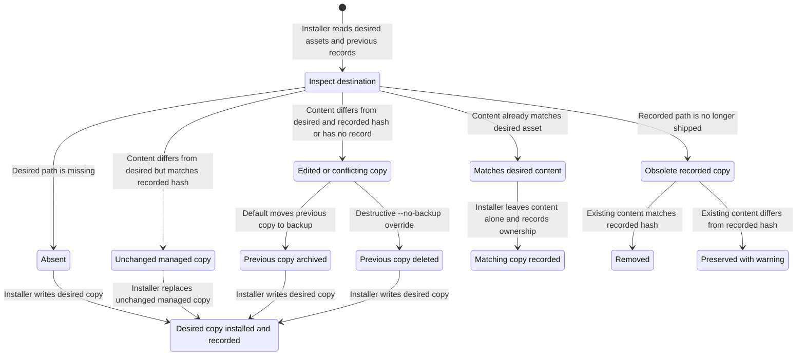
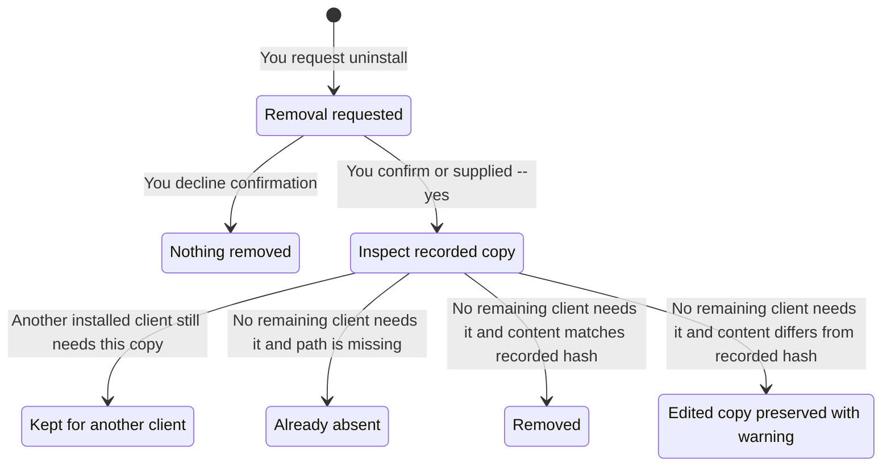

# Installation and your files

These diagrams follow one managed copy, such as a skill, the floor, or a role definition. The installer compares its content hash with the record in `~/.harness/state.json`. They do not describe client settings or MCP registrations, which are reconciled separately. Tracked settings can overwrite in-app preferences.

## Installing

Run `harness install` to install the binary's embedded assets, or `go run ./cmd/harness install --skip-packages` to apply checkout assets without installing packages. Both change live client configuration.

Archives go under `~/.dotfiles-backups/harness/`. `--no-backup` deletes conflicting content instead of archiving it. `--clear-backups` separately deletes those archives. Neither operation is recoverable through the harness.

An obsolete copy that is already absent needs no removal. Private entries outside the desired paths and recorded copies stay untouched. A managed copy can be a directory, so an edit anywhere inside it changes its hash. Managed-root symlinks are moved aside before installation.

## Uninstalling

Run `harness install --uninstall`. Removal asks for confirmation unless you pass `--yes`. Client and component filters narrow the selection.

Uninstall removes ownership records for copies no remaining client needs, including edited copies it preserves. A preserved file is therefore no longer managed. Unrecorded private entries remain untouched.

Uninstall also removes selected managed settings, shell integration, and MCP registrations through their own rules. It leaves installed packages, backups, and user data. A full uninstall removes `~/.harness`, including saved model assignments and the review-level choice.
