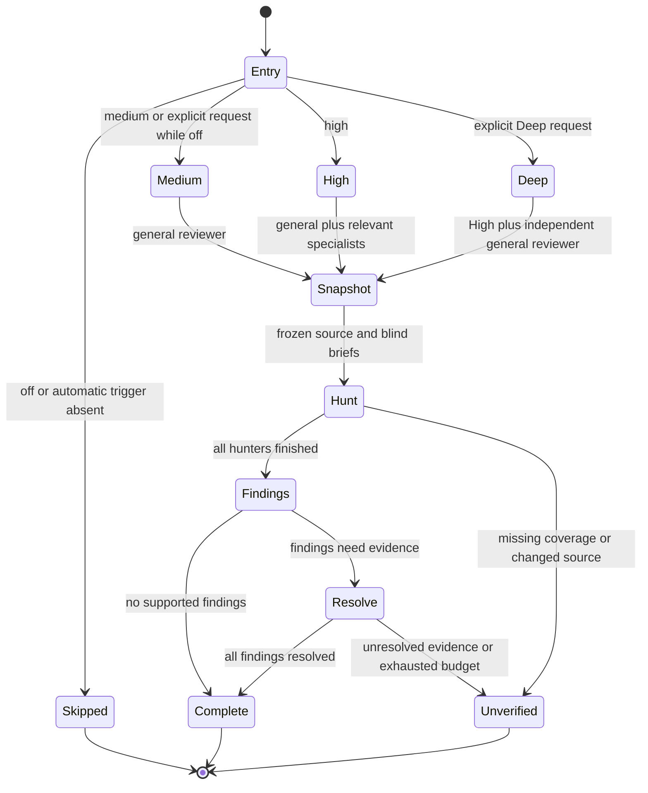
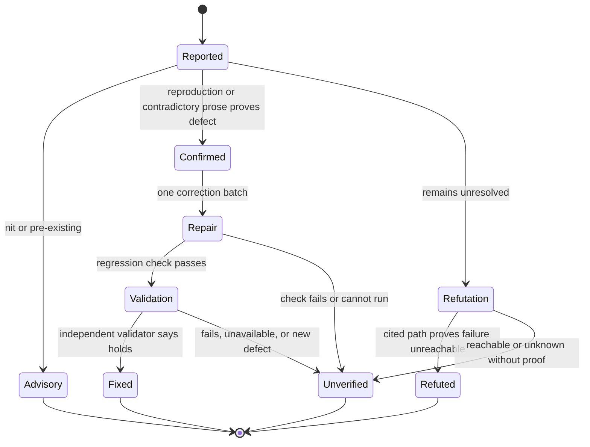

# How review works

Review gives a change an independent reading before delivery. The reviewer sees the requirements, source, diff, and project conventions, without the author's rationale. Tests establish observed behavior; review looks for mistakes the tests and author missed.

## Levels control independent perspectives

Medium uses one general reviewer covering correctness, requirements, error paths, compatibility, relevant security risks, conventions, and test gaps. A specialist is an additional perspective, not the only place a question gets checked.

High adds one or two specialists where the change warrants them: requirements, consequential risks, or interfaces and structure. For example, a retry change deserves deeper failure and concurrency analysis. It need not purchase a separate style review. Explicit Deep adds a second general reviewer from another vendor when the installed assignments support that.

The setting and risk answer different questions. Your level controls how much independent scrutiny you want. The change's risk controls automatic entry and which specialists are useful. An explicit review keeps the selected level; with review off, an explicit request uses Medium. Asking for a review does not silently select High.

Automatic Medium reviews cover PRs above documentation and test-only changes, and local handoffs with critical or concrete security, data-loss, compatibility, or concurrency risk. High also covers structural and behavioral local handoffs. Unattended build reviews ordinary implementation at Medium too.

## Findings need evidence

The author can confirm a defect with a reproduction but cannot dismiss it alone. Medium reproduces findings inline. High and Deep may use one batch executor when executable evidence is needed. A fresh refuter receives only unresolved findings and the original source, without the author's explanation or reproduction artifacts.

A green reproduction alone does not refute a finding. Substantive repairs receive a targeted independent validator at every level, including Medium. The validator checks the repair rather than starting another broad hunt. Unresolved findings return to the human instead of opening an unlimited correction loop.

## Budgets cover the whole review

Medium permits three role calls: one general reviewer, a conditional refuter, and a conditional fix validator. A clean review normally spends only the first call. High permits six calls, enough for three hunters and conditional reproduction, refutation, and validation. Deep permits seven by adding the independent general reviewer.

Retries, delegated corrections, and slices consume the same budget. Splitting a large diff does not multiply it. Required work that cannot fit is reported as unverified, with the missing coverage named. These are invocation limits, not dollar or token guarantees.

The source snapshot and evidence identify the reviewed revision. Findings and fixes remain in the existing branch ledger. A changed source invalidates affected evidence; a clean outcome applies only to the inspected scope. Review does not grant permission to push or merge.

The [review skill](../skills/workflow/review/SKILL.md) defines the executable procedure. These diagrams explain its intended flow; they are not a model-checked proof or evidence of live agent behavior.
