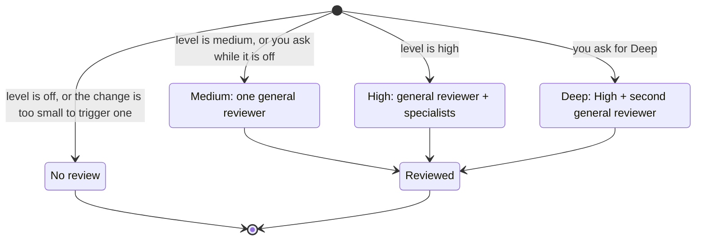
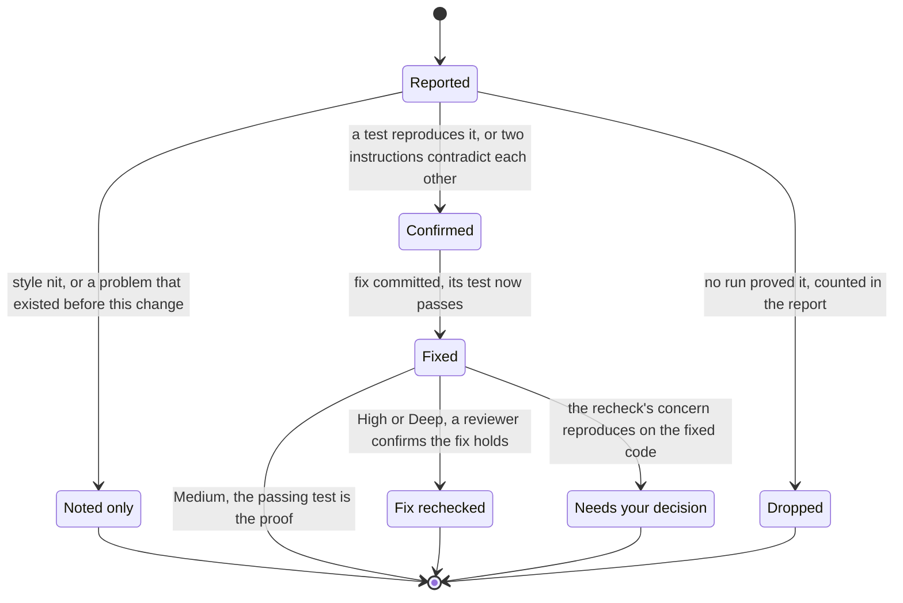

# How review works

Review gives a change a second pair of eyes before it reaches you. Other agents read the change without hearing why the author wrote it that way, so they judge the code rather than the explanation. Tests show what the code does; review looks for what the tests and the author missed.

Reviewers raise anything they can trace, but only problems a run proves reach you. A finding nobody could prove is dropped, and you see how many each reviewer had dropped. The author never dismisses a finding by arguing with it.

## Pick how much review you want

Your review level decides when reviews start on their own and how many agents they may use. Set it with `harness review level off|medium|high`; `medium` is the default. Only you change it.

| Level | Starts on its own for | Who reviews | Most agents per review |
| --- | --- | --- | --- |
| `off` | Nothing | (an explicit request runs at Medium) | 0 unless you ask |
| `medium` | Every PR beyond docs or tests, and local work that is critical or names a security, data-loss, compatibility, or concurrency risk | One general reviewer | 2 |
| `high` | Every PR or local change that is structural or riskier | The general reviewer plus one or two specialists | 6 |
| Deep | Only when you ask for it by name | High plus a second general reviewer | 7 |

Asking for a review always runs one, at your configured level (Medium when the level is `off`). It never silently upgrades to High.

The general reviewer covers correctness, requirements, error handling, compatibility, relevant security, project conventions, and missing tests. A specialist digs deeper into one area where the change needs it:

- **Requirements:** does the change do exactly what the ticket or spec asked, no more and no less?
- **Risk:** trust boundaries, data loss, failing dependencies, or concurrency.
- **Standards:** changed interfaces, structure, and the project's documented conventions.

Deep's second general reviewer comes from another model vendor when your setup allows it. Every finding from either reviewer is kept, because different models catch different bugs.

## What happens during a review

1. **Freeze the change.** The agent commits its work, and reviewers read exactly that commit. Nothing is edited until every reviewer has reported.
2. **Hunt.** Reviewers get the requirements (copied word for word), the diff, and the project's standards. They never see the conversation or the author's reasoning.
3. **Prove each finding.** The agent tries to reproduce every problem by running a small test or script. At High and Deep, a separate agent can run what the main agent could not. Contradictory instructions are proven by quoting both. Everything else is dropped and counted.
4. **Fix and check.** Each confirmed problem is fixed with a test that failed before the fix and passes after; for contradictory instructions, the fix is rewording them so they agree. At High and Deep, one more reviewer reads the fix to make sure it solves the root cause and breaks nothing else.

## What happens to a finding

Dropping trades some recall for a report you can trust: every finding you read was run. The review evals count real bugs the rule dropped, so the trade stays measured. There is only ever one round of fixes. If a fix does not hold, the agent brings it to you instead of looping.

## What you get at the end

- The level used, which reviewers ran and why, and how many agents it took.
- The exact commit that was reviewed and which standards the reviewers read.
- Proven findings grouped by reviewer, worst first within each group, each marked confirmed or fixed, plus how many each reviewer had dropped and why.
- Anything that could not be covered, such as a reviewer that failed or a part of the change too large to fit.

Your decisions are recorded too: "this is intended" or "not worth fixing" keeps your words as the reason. `/land` asks you to reconfirm any dismissal.

## Where results live

Findings stay on your machine in a per-branch ledger inside the Git directory. They never go into commits, and a PR only carries one `Reviewed: <base>..<sha>` line. `/land` deletes the ledger once the branch merges. See [`harness review`](cli.md#review-commands) for reading it.

At Medium and High, `/land` holds a PR beyond docs or tests until a review covers its latest commit. Review never pushes or merges on its own.

## Limits

- Agent counts are caps, not cost guarantees. Retries, delegated fixes, and splitting a large change all count against the same cap; what does not fit is reported as unreviewed.
- A clean review applies only to the commit it read. New commits need the affected parts rechecked.
- The [review skill](../skills/workflow/review/SKILL.md) is the exact procedure agents follow. These diagrams explain it; they are not proof of how agents behave in practice.
