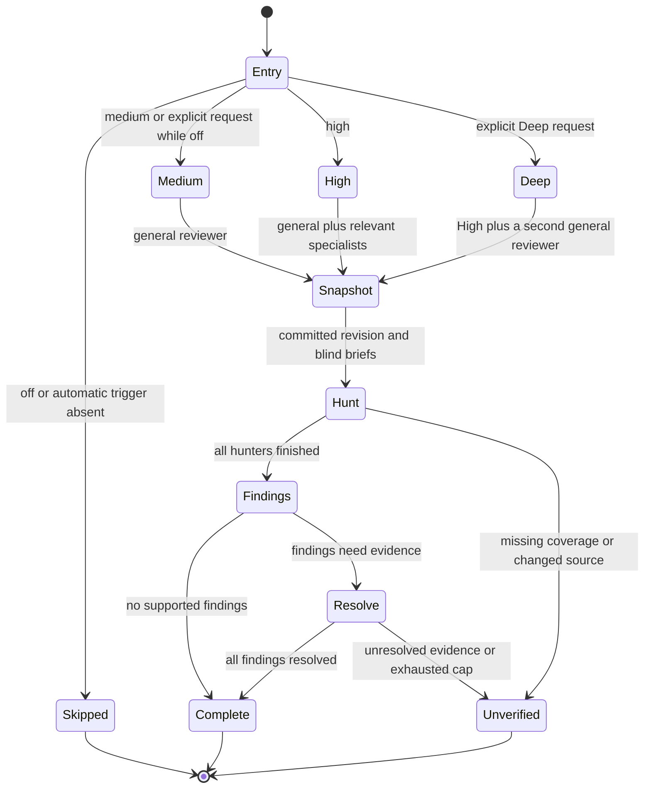
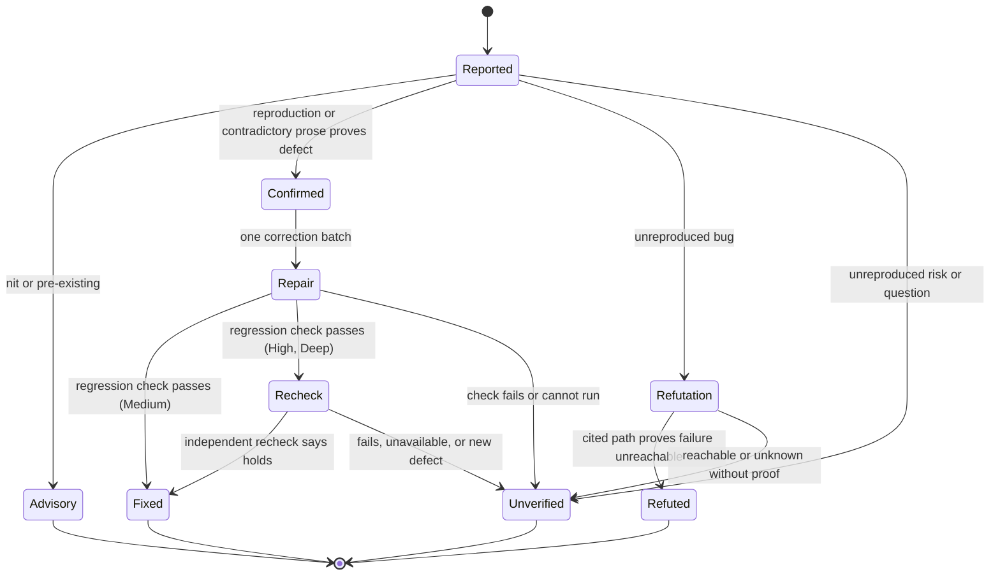

# How review works

Review gives a change an independent reading before delivery. The reviewer sees the requirements, source, diff, and project conventions, without the author's rationale. Tests establish observed behavior; review looks for mistakes the tests and author missed. A missed defect costs more than an extra question, so review favors recall: nothing is dropped on the author's word.

## Levels control independent perspectives

Medium uses one general reviewer covering correctness, requirements, error paths, compatibility, relevant security risks, conventions, and test gaps. A specialist is an additional perspective, not the only place a question gets checked.

High adds one or two specialists where the change warrants them: requirements, consequential risks, or interfaces and structure. For example, a retry change deserves deeper failure and concurrency analysis. It need not purchase a separate style review. Explicit Deep adds a second general reviewer, from another vendor when the installed assignments support that, and keeps the union of both reports, because different models catch different defects.

The setting and risk answer different questions. Your level controls how much independent scrutiny you want. The change's risk controls automatic entry and which specialists are useful. An explicit review keeps the selected level; with review off, an explicit request uses Medium. Asking for a review does not silently select High.

Automatic Medium reviews cover PRs above documentation and test-only changes, and local handoffs with critical or concrete security, data-loss, compatibility, or concurrency risk. High also covers structural and behavioral local handoffs. Unattended build reviews ordinary implementation at Medium too.

## Findings need evidence

The author can confirm a defect with a reproduction but cannot dismiss it alone. The parent tries to reproduce every finding. At High and Deep, one batch executor may run what the parent could not. Only an unreproduced bug goes to a fresh refuter, which receives the findings and the source without the author's explanation. An unreproduced risk or question goes straight to the human.

A green reproduction alone does not refute a finding. At Medium, the red check turning green proves the repair. At High and Deep, one recheck reviewer reads the repair delta rather than starting another broad hunt. Unresolved findings return to the human instead of opening an unlimited correction loop.

## Caps cover the whole review

Medium permits two role calls: one general reviewer and a conditional refuter. A clean review spends one call and creates no worktree. High permits six: up to three hunters plus a conditional executor, refuter, and recheck. Deep permits seven by adding the second general reviewer.

Retries, delegated corrections, and slices count against the same cap. Splitting a large diff does not multiply it. Required work that cannot fit is reported as unverified, with the missing coverage named. These are invocation limits, not dollar or token guarantees.

Reviewers read a committed revision. Only the High executor gets a detached worktree, removed once its work is saved. Findings and fixes remain in the existing branch ledger. A changed revision invalidates affected evidence; a clean outcome applies only to the inspected scope. Review does not grant permission to push or merge.

The [review skill](../skills/workflow/review/SKILL.md) defines the executable procedure. These diagrams explain its intended flow; they are not a model-checked proof or evidence of live agent behavior.
