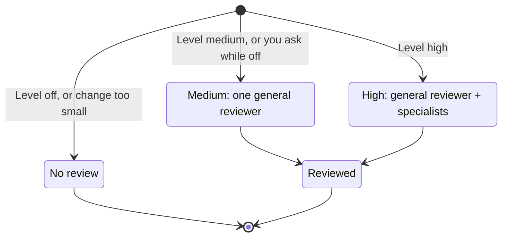
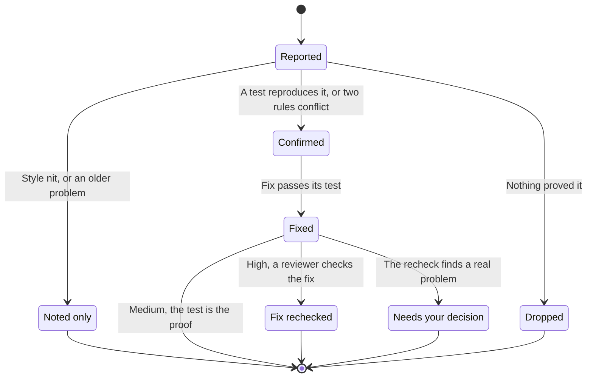

# How review works

Review gives a change a second pair of eyes before it reaches you. Other agents read the change without hearing why the author wrote it that way, so they judge the code and not the explanation. Tests show what the code does. Review looks for what the tests and the author missed.

The key rule: **only problems a run proves reach you.** Reviewers can raise anything they suspect, but the agent must reproduce each problem with a test or a script before it counts. A finding nobody could prove is dropped, and the report tells you how many were dropped. The author never gets to dismiss a finding by arguing with it.

## Pick how much review you want

Your review level decides when a review starts on its own and how many agents it may use. `medium` is the default. Only you can change it:

```sh
harness review level high    # off, medium, or high
```

| Level | Starts on its own for | Who reviews | Most agents per review |
| --- | --- | --- | --- |
| `off` | Nothing | Nobody, unless you ask (then it runs as `medium`) | 0 unless you ask |
| `medium` | Every PR (or `/build` integration branch) beyond docs or tests, and local work that is critical or names a security, data-loss, compatibility, or concurrency risk | One general reviewer | 2 |
| `high` | Every PR or local change beyond docs, tests, and mechanical edits | The general reviewer plus one or two specialists | 6 |

The kinds of change ("critical", "docs or tests", "mechanical") are the review tiers that `change-map` assigns to each changed file.

Asking for a review always runs one, at your level (or at `medium` when the level is `off`). It never quietly upgrades to `high`. Under `/work`, every playbook that changes code calls review before it hands off, so you do not need to ask. The table still decides whether it runs and how deep it goes.



## Review something other than your branch

Ask for a review of a PR number or URL, another branch, or a commit range such as `abc123..def456`, and you don't need it checked out. The agent fetches it, gives the reviewers a temporary copy of it, and deletes that copy when the review ends. Such a review only reports: it fixes nothing and pushes nothing, and you send the findings to the PR's branch with `/address-review`. When the target has an open PR, the agent asks at the end whether to post the result there, unless your request already said to post it. Say yes and it posts one comment with the confirmed findings and how each was proven. It never approves the PR or requests changes on it; that stays with you. Say no and nothing appears on the PR. A PR from a fork is reviewed without running any of its code, so only findings that need no run can be proven.

A clean review of a PR by number counts for `/land` even though nothing is written on the PR, because `/land` also reads the review record on your machine.

## Who reviews

The **general reviewer** checks correctness, requirements, error handling, compatibility, relevant security, project conventions, and missing tests.

At `high`, a **specialist** digs deeper into one area where the change needs it:

- **Requirements:** does the change do exactly what the ticket or spec asked, no more and no less?
- **Risk:** trust boundaries, data loss, failing dependencies, or concurrency.

Each kind of reviewer is its own role: `review-bugs`, `review-spec`, `review-risk`, and `reviewer` for rechecking a fix. They all run on the model and effort you chose for `reviewer` with `harness models`. To give one of them its own model, set it directly:

```sh
harness models set review-risk --client claude --model opus --effort high
```

## What happens during a review

1. **Freeze the change.** The agent commits its work, and reviewers read exactly that commit. Nothing is edited until every reviewer has reported.
2. **Hunt.** Reviewers get the requirements, copied word for word, and the diff. They read the project's standards and principles themselves. They never see the conversation or the author's reasoning.
3. **Prove each finding.** The agent tries to reproduce every problem with a small test or script. At `high`, a separate agent can run what the main agent could not. Two instructions that contradict each other are proven by quoting both. Everything else is dropped and counted.
4. **Fix and check.** Each confirmed problem is fixed together with a test that failed before the fix and passes after it. For contradictory instructions, the fix rewords them so they agree. At `high`, one more reviewer reads the fix to make sure it solves the root cause and breaks nothing else.

There is only ever one round of fixes. If a fix does not hold, the agent brings it to you instead of looping.

## What happens to a finding



### Why unproven findings are dropped

Dropping unproven findings means some real bugs slip through. In exchange, every finding you read has been run, so you can trust the report. The review evals count the real bugs this rule drops, so the cost of the trade stays measured.

## What you get at the end

- The level used, which reviewers ran and why, and how many agents it took.
- The exact commit that was reviewed, and which standards the reviewers read.
- The proven findings, grouped by reviewer and worst first within each group, each marked confirmed or fixed.
- How many findings each reviewer had dropped, and why.
- Anything the review could not cover, such as a reviewer that failed or a part of the change too large to fit.

Your own decisions are recorded too. When you say "this is intended" or "not worth fixing", your words are kept as the reason. `/land` asks you to reconfirm any finding you dismissed.

## Where results live

Findings stay on your machine, in a ledger for each branch inside the Git directory. When a skill calls for a review and the ledger already holds one that covers the same commit at that level or deeper, the agent reports that review and does not run a second one. A review you ask for by name always runs. They never go into commits. A PR carries only one line, `Reviewed: <base>..<sha>`. `/land` deletes the ledger once the branch merges. The [`harness review` commands](cli.md#review-commands) show you how to read it.

At `medium` and `high`:

- The PR's readiness report says whether a review covers its latest commit.
- `/land merge` refuses to merge a PR beyond docs or tests until one does. For a PR someone else wrote, a person's approval on GitHub counts as that review, as long as the changes are still the ones they approved. Your own PRs always need the agent's review.
- `/land` after your own merge tells you when no review covered it.

Review never pushes or merges on its own.

## Limits

- **Agent counts are caps, not cost guarantees.** Retries, delegated fixes, and splitting a large change all count against the same cap. Whatever does not fit is reported as unreviewed.
- **A clean review covers only the commit it read.** New commits need the affected parts rechecked.
- **This page explains, it does not prove.** The [review skill](../skills/workflow/review/SKILL.md) is the exact procedure agents follow. The diagrams here describe it, but they do not prove how agents behave in practice.
