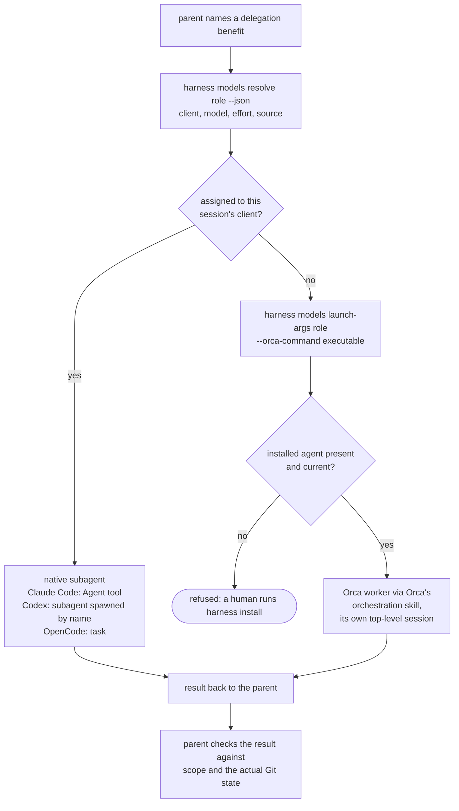
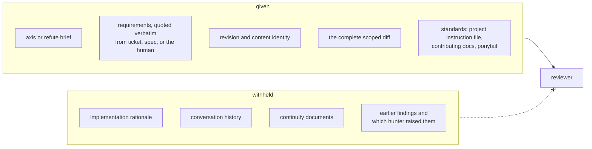
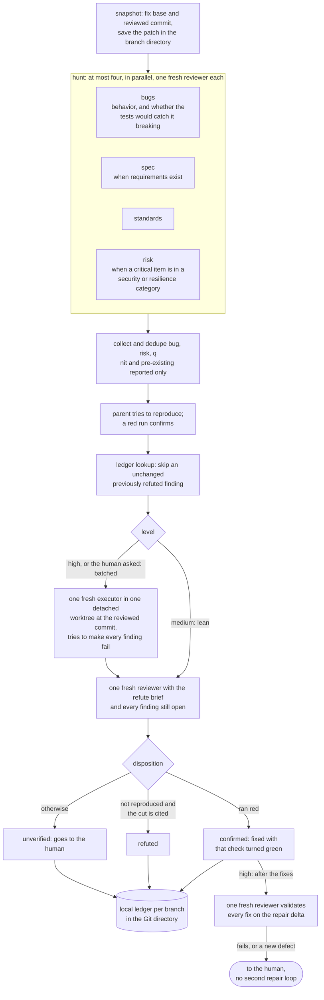

# Subagents

The harness delegates to three named roles. This page explains what each one does, when a parent hands work to one, how the launch is routed, and how `review` uses them. The role definitions themselves are the source of truth, and `POLICY.md`'s Delegation section is the rule.

## Work inline by default

A parent delegates only for a named benefit: independent inspection, useful parallel work, or context isolation. File count and diff size are not reasons. When a role cannot launch, the parent says so and works inline where independence is not required; a review that needs independence is reported unverified instead, never replaced by self-review.

## The roles

| Role | Does | Access | Returns | Definition |
| --- | --- | --- | --- | --- |
| `executor` | Implements one bounded slice inside the scope the parent names | Edits and commands inside that scope; never commits, pushes, opens a PR, changes a ticket, merges, removes a worktree, or delegates | One result: slice, dispatch, branch, revision, changed and pending files, checks, unresolved items, artifacts | `roles/executor.md` |
| `code-search` | Answers one question about the repository | Read and search only | One citation per line: `path:line \| symbol \| mechanism` | `roles/code-search.md` |
| `reviewer` | Hunts one review axis, or tries to refute a batch of findings, blind to the rationale | Read and search only | A header (`loaded:`, `revision:`, `axis:`, `findings:`, `summary:`) and findings by severity: `bug`, `risk`, `q`, `pre-existing`, `nit` | `skills/review/roles/reviewer.md` |

An executor brief carries five things: the goal, the scope it may touch, the exact base SHA, how to verify it, and what to report. An executor missing one asks rather than guesses.

## Routing a launch

Each machine chooses, per role, which client, model, and effort runs it (`harness models`; see the Assignments section of `README.md`). The launch then follows that choice.

A completion message is never evidence. The parent reruns the checks, reads the worktree, and keeps complete results before releasing any disposable resource. An Orca worker's read-only role gets a blocking permission hook that allows only Orca's own `orchestration send`, `ask`, and `check`.

The presets in `harness models`:

| Preset | Executor | Code search | Reviewer |
| --- | --- | --- | --- |
| `balanced` (default) | Codex `gpt-6-luna` | `sonnet` | `opus` at high effort |
| `performance` | a top Claude model at high effort | the same | the same |
| `economy` | Codex `gpt-5.6-luna` | `haiku` | the cheapest viable model |
| `diversity` | as `balanced` | as `balanced` | Codex `gpt-6.1-sol` at high effort |

## Blind inputs

A reviewer that has not heard the implementer's reasoning judges the code, not the story. So the parent withholds the story from every reviewer and verifier.

Standards outside the project arrive inline, because a read-only role cannot read outside it. `code-search` gets even less: one question and the repository, with no hypothesis to confirm.

## How `review` uses them

`review` runs at the depth the human's review level and the `change-map` tier allow, and the author never dismisses a finding alone.

Each level, and at `high` each depth, launches these subagents. Hunters, the refuter, and the fix validator are `reviewer` agents; the verifier is an `executor`.

| Level | Depth (set by) | Hunters (`reviewer`) | Verifier (`executor`) | Refuter (`reviewer`) | Fix validator (`reviewer`) | Total at most |
| --- | --- | --- | --- | --- | --- | --- |
| `off` | none | 0 | 0 | 0 | 0 | 0 |
| `medium` | Quick | 1: `bugs` | 0 (the parent reproduces findings itself) | 1 | 0 | 2 |
| `medium` in `/build` | Quick plus `spec` | 2: `bugs`, `spec` | 0 | 1 | 0 | 3 |
| `high` | none (only `mechanical` or `tests-docs`) | 0 | 0 | 0 | 0 | 0 |
| `high` | Quick (`structural` or `behavioral`) | 1: `bugs` | 1 | 1 | 1 | 4 |
| `high` | Standard (`critical`, or the human asks) | up to 4: `bugs`, `spec` when requirements exist, `standards`, `risk` when a critical item is in a security or resilience category | 1 | 1 | 1 | 7 |
| `high` | Deep (a critical one-way door, or the human asks for Deep) | up to 4: Standard plus a second `bugs` from another vendor, dropping `standards` when that would make five | 1 | 1 | 1 | 7 |

The verifier and refuter launch only when findings are still open after the parent's own reproduction, so a clean hunt stops at the hunters. The fix validator launches once, after every confirmed finding is fixed, and only when a fix changed behavior; a fix it rejects goes to the human rather than into a second repair loop. A review the human asks for always verifies batched, with one verifier. A diff too large for one hunter is split into slices, and each slice gets its own set, which multiplies these counts. Fixes for confirmed findings go to one fresh `executor` in one brief, or are made inline; that executor is on top of the totals.

The four axes:

| Axis | Hunts | Brief |
| --- | --- | --- |
| `bugs` | Defects that change behavior: root cause, callers a grep misses, error paths, instruction drift, and whether the tests would catch the change breaking (assertions on visible behavior, edge cases, nondeterminism, skipped or focused tests) | `skills/review/references/bugs.md` |
| `spec` | Requirements missing, partial, implemented wrong, or exceeded | `skills/review/references/spec.md` |
| `standards` | Documented rules, `ponytail`, and the smell baseline; mostly judgement calls | `skills/review/references/standards.md` |
| `risk` | Security (a reachable trust-boundary violation) and resilience (timeouts, retries, partial state and rollback, concurrency, visibility of new failures, measured performance) | `skills/review/references/risk.md` |

`bugs` carries what Gentle AI calls reliability, and `risk` carries its risk and resilience lenses, so four hunters cover all of them.

Deep needs the reviewer assigned to a client other than the session's (the `diversity` preset does this). Its assigned hunters then launch through Orca and the extra `bugs` hunter launches natively, so two vendors hunt bugs; when the reviewer resolves to the session's client, review runs at Standard instead. There is never one verifier or refuter per finding: the batch keeps cost flat as findings grow.

Code from a fork's pull request is never run; its findings are only walked.

The ledger lives at `$(git rev-parse --git-common-dir)/harness-review/branches/<branch>/ledger.jsonl`. Git never tracks it, it never reaches a commit or pull request body, and `/land` or `/abandon` deletes it with the branch.

## Executors in `/build`

`/build` launches one executor per frontier slice, each in its own worktree branched from the integration branch's current head, and tells each to use `tdd` at the agreed seams. The parent checks each result, commits it on the worker's branch, merges it into the integration branch, and retires the worktree only when it is merged and clean. See `docs/workflow.md` for the whole flow.

## What each client enforces

Every restriction is best effort. Claude Code and OpenCode enforce the read-only roles through their tool lists and permissions; the executor's limits on commits, pushes, pull requests, and the tracker are partly instructions, since a client cannot always remove one Bash command without removing Bash. A Codex worker under Orca runs in a workspace-write sandbox with network on, where `.git` stays read-only so commits fail. The per-client table, with what each client does not enforce and what remains unverified, is in the Role agents section of `README.md`.
