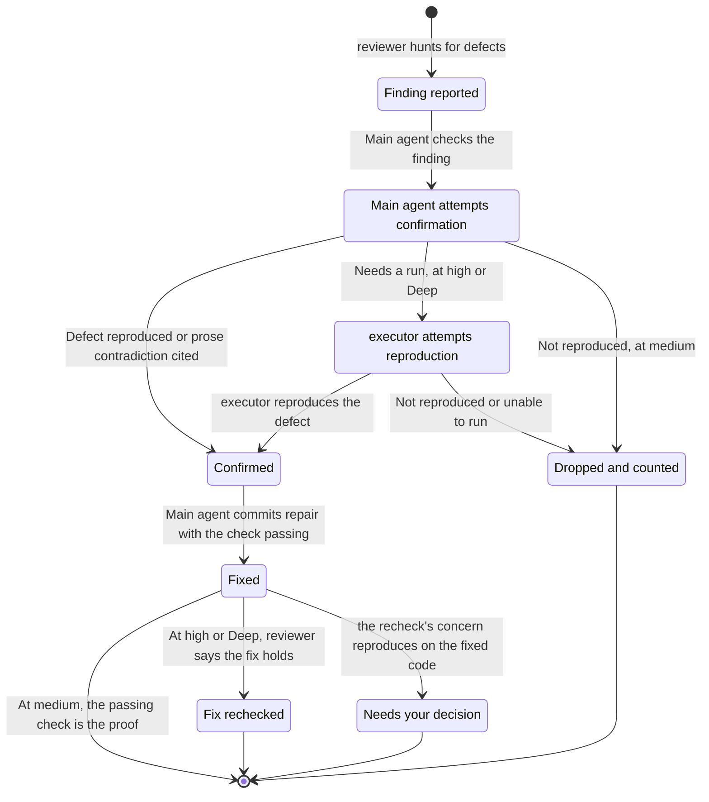

# Delegation

Work stays inline unless a worker offers independent inspection, useful parallel work, or context isolation. More files alone are not a reason to delegate.

## Roles

| Role | Job | Limits |
| --- | --- | --- |
| `executor` | Implement one bounded slice | No commits, publication, tracker writes, merges, worktree removal, or further delegation |
| `code-search` | Answer one repository question with file and line citations | Read and search only |
| `reviewer` | Find defects, challenge findings, or validate fixes | Read and search only; does not receive the author's rationale |

Definitions live in [roles/](../roles/) and [the review skill](../skills/workflow/review/SKILL.md). A worker's completion message is not proof: the parent checks its scope, Git state, and results.

## Launching a role

Resolve the assignment with `harness models resolve <role> --json`. A role assigned to the session's client uses a native subagent. A role assigned to another client runs only in a T3 Code session, through `delegate_task` with the provider, model, and effort the assignment maps to; POLICY's Delegation section gives the mapping. A T3 Code child loads no installed role agent, so its brief opens with the role definition.

A missing or stale installed role needs deliberate `harness install` provisioning. Do not silently substitute another agent. If independence is required and the reviewer cannot run, report the review as unverified.

Use `harness models --help` for presets and overrides. The parent retains complete worker results before releasing disposable resources. Releasing a worker does not authorize removing its worktree.

## Reviews

Reviewers receive requirements, a revision identity, the scoped diff, and project standards. They do not receive implementation rationale, conversation history, or continuity notes.

At `medium`, one general reviewer hunts and the main agent runs its findings. At `high`, one or two specialists (requirements, consequential risk, or structure and conventions) join the general reviewer, an `executor` may reproduce findings, and fixes get one recheck. An explicit Deep review adds a second general reviewer and keeps the union of both reports. The [review skill](../skills/workflow/review/SKILL.md) defines the exact worker counts and procedure.

Only findings a run proves survive; the rest are dropped and counted. Confirmed findings need fixes. Findings stay in a local per-branch ledger inside the Git directory, not in commits or PR bodies.

## Finding lifecycle

This follows one actionable finding through the review skill. The subagent roles are `reviewer` and `executor`. **Main agent** means your primary session, called the parent in the skill. Hunting and the fix recheck use separate `reviewer` instances, not additional roles. The main agent can repair findings itself or delegate repairs to an `executor`, but only the main agent commits. Findings are deduplicated first. Nits and pre-existing defects are reported separately.

The main agent tries to reproduce every finding. At `high` and Deep, an `executor` also runs findings the main agent could not reproduce inline. Code from fork PRs is not run during review. Prose contradictions can be confirmed by citing the conflicting instructions. Anything no run proves is dropped, and the report counts the drops per reviewer, so you read only proven defects.

A failed recheck or a new defect it names is run on the fixed code; if it reproduces, it comes to you. The main agent does not start a second repair loop on its own. A changed reviewed revision needs its affected evidence rechecked.

## Enforcement limits

Client restrictions differ. Claude Code and OpenCode restrict read-only roles with tool permissions and shell guards. Some executor limits remain instructions. Native Codex subagents inherit the parent's sandbox. A T3 Code delegate runs in the runtime mode it inherits, and T3 Code has no read-only mode, so a delegated role's access limits are instructions in its brief.

These are best-effort controls. Repository tests validate generated configuration, not live compliance. Runtime enforcement remains unverified until an authorized probe runs against the installed client.
