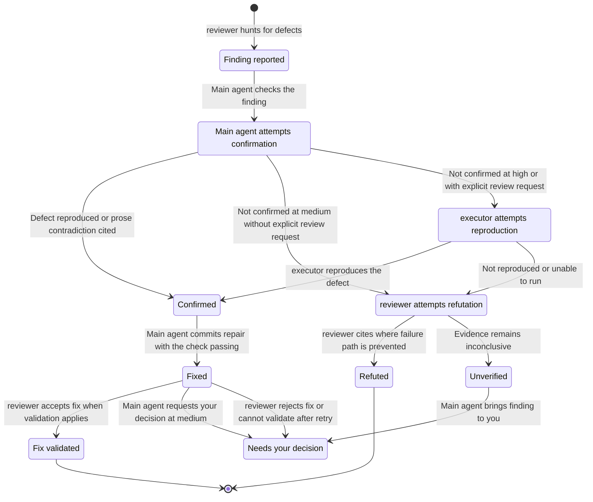

# Delegation

Work stays inline unless a worker offers independent inspection, useful parallel work, or context isolation. More files alone are not a reason to delegate.

## Roles

| Role | Job | Limits |
| --- | --- | --- |
| `executor` | Implement one bounded slice | No commits, publication, tracker writes, merges, worktree removal, or further delegation |
| `code-search` | Answer one repository question with file and line citations | Read and search only |
| `reviewer` | Find defects, challenge findings, or validate fixes | Read and search only; does not receive the author's rationale |

Definitions live in [roles/](../roles/) and [the review skill](../skills/workflow/review/SKILL.md). A worker's completion message is not proof: the parent checks its scope, Git state, and results.

## Launching a role

Resolve the assignment with `harness models resolve <role> --json`. A role assigned to the session's client uses a native subagent. A role assigned to another client uses Orca and its orchestration guide, with arguments prepared by `harness models launch-args`.

A missing or stale installed role needs deliberate `harness install` provisioning. Do not silently substitute another agent. If independence is required and the reviewer cannot run, report the review as unverified.

Use `harness models --help` for presets and overrides. The parent retains complete worker results before releasing disposable resources. Releasing a worker does not authorize removing its worktree.

## Reviews

Reviewers receive requirements, a revision identity, the scoped diff, and project standards. They do not receive implementation rationale, conversation history, or continuity notes.

At `medium`, reviews use a lean bug hunt and independent refutation when needed. At `high`, review depth follows the change's risk and may add specification, standards, and security or resilience checks. Explicit review requests use batched verification. The [review skill](../skills/workflow/review/SKILL.md) defines the exact worker counts and procedure.

The author may reproduce a finding but cannot dismiss it alone. Confirmed findings need fixes; unresolved findings go to the human. Findings stay in a local per-branch ledger inside the Git directory, not in commits or PR bodies.

## Finding lifecycle

This follows one actionable finding through the review skill. The subagent roles are `reviewer` and `executor`. **Main agent** means your primary session, called the parent in the skill. Hunting, refutation, and fix validation use separate `reviewer` instances, not additional roles. The main agent can repair findings itself or delegate repairs to an `executor`, but only the main agent commits. Findings are deduplicated first. Nits and pre-existing defects are reported separately.

At `medium`, the main agent tries to reproduce findings. At `high`, or for an explicitly requested review, an `executor` also tests remaining findings. Code from fork PRs is not run during review, so those findings go to the `reviewer` for refutation without executor reproduction. Prose contradictions can be confirmed by citing the conflicting instructions instead of running a test. Refutation requires both a finding that was not reproduced and a `reviewer`'s cited explanation of where its failure path is prevented.

Fix validation by a `reviewer` applies at `high` or for an explicitly requested review when the repair changes behavior. A successful validation leaves the ledger disposition `fixed`; **Fix validated** is a diagram label. Fixes without behavior changes need no validation by a `reviewer`. At `medium`, substantive repairs await your decision.

Inconclusive evidence, failed validation, and new defects discovered during validation are recorded as `unverified` and brought to you. The main agent does not start a second repair loop on its own. A changed review snapshot needs its affected evidence rechecked.

## Enforcement limits

Client restrictions differ. Claude Code and OpenCode restrict read-only roles with tool permissions and shell guards. Some executor limits remain instructions. Codex workers launched through Orca use a workspace-write sandbox with network access; it blocks commits through read-only Git metadata, but read-only role behavior and publication limits still depend on instructions. Native Codex subagents inherit the parent's sandbox.

These are best-effort controls. Repository tests validate generated configuration, not live compliance. Runtime enforcement remains unverified until an authorized probe runs against the installed client.
