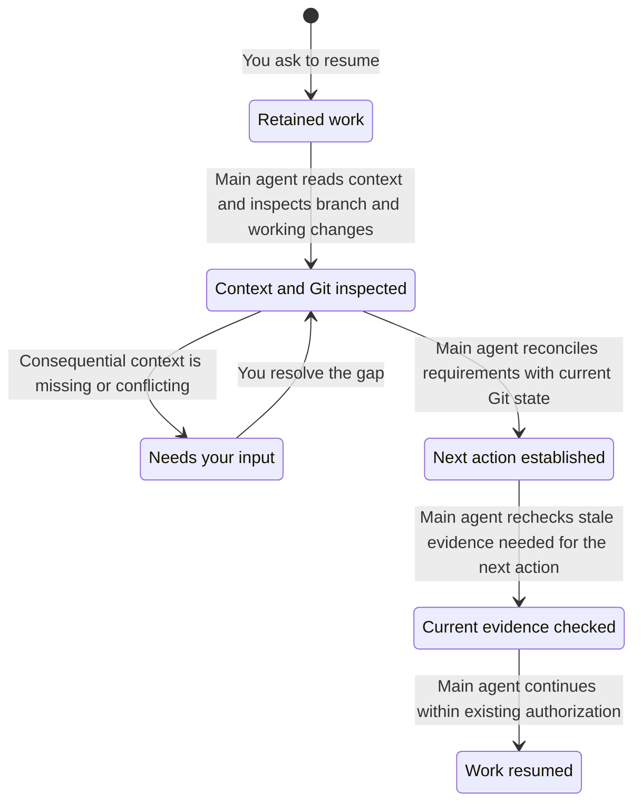

# Working with the harness

Start with a plain request. The agent inspects the repository, implements the agreed scope, checks it, and reports. You do not need a ticket, specification, or ceremony for ordinary work.

## Choose help when you need it

| Situation | Skill |
| --- | --- |
| A fuzzy idea needs decisions | `/grill-with-docs` |
| A ticket needs investigation before implementation | `/triage` |
| A question needs evidence | `research` |
| An experiment would settle an uncertainty | `proto` |
| A design needs a durable specification | `/spec` |
| A bug needs reproduction and diagnosis | `diagnosing-bugs` |
| You want test-first implementation | `tdd` |
| A frontend needs design work | `impeccable` |
| A state machine needs model checking | `/statechart` |
| A release needs browser QA | `/e2e-verification` |
| A session needs a retrospective | `/retro` |

These are independent tools. Using one does not require or automatically start another. A slash marks an explicit invocation here; consult each skill for its inputs.

## Local work and delivery

An implementation request authorizes local edits and commits on a task branch the agent creates. Consequential decisions come back to you; routine reversible choices do not need repeated approval.

“Open a PR” or “ship this” authorizes commits, push, PR creation or updates, and required-check repairs. Feedback stays on the same branch. Publication does not authorize merging: invoke `/land` for that.

Before handoff, the agent runs the repository checks and explains what changed, what to review, and any gaps. Review depth follows your `harness review level` setting. At `medium` and `high`, landing a PR above `tests-docs` requires review of its current patch.

The [README state diagram](../README.md#everyday-use) shows the delivery path:

- **Ready locally:** the requested local work and applicable checks are complete. No publication is required.
- **Preparing PR:** publication is authorized. The agent completes local checks and applicable review before publishing.
- **PR open:** remote checks and feedback may require more changes on the same branch. Changed code needs fresh checks and any applicable review.
- **Ready to merge:** required checks and review are satisfied. The agent waits for your `/land`, then rechecks the gates before merging.
- **Needs your input:** a consequential decision or unavailable required check or reviewer blocks progress. Once resolved, work returns to the blocked stage. A failed check the agent can repair stays in the normal work loop.

These describe the intended workflow, not a centrally enforced task status. Live agent compliance is separate from the written policy.

See the [finding lifecycle](subagents.md#finding-lifecycle) for how review concerns are confirmed, refuted, repaired, and validated.

For longer work, the agent keeps requirements, decisions, evidence, and the next action in `docs/agents/tasks/<feature>.md`. Small tasks need no extra document.

## Larger builds

Invoke `/build` to implement a specification's slices or a set of tickets unattended. It uses one integration branch and bounded workers in separate worktrees. The parent verifies and commits their results, then checks and reviews the combined change. Publication still requires a delivery request; merging still requires `/land`.

Use this when the work is settled enough to delegate. Missing acceptance criteria, disputed test seams, or shared assumptions need resolving first.

## Optional tracking

Invoke `setup-harness` to configure a repository's tracker. GitHub mode installs labels and a lifecycle workflow; local mode stores status in Markdown. Ordinary coding needs neither.

GitHub dependencies become ready only when their blockers were closed by merged PRs. Closing an issue manually does not count. A parent closes when all required children have merge evidence. Tracker writes and ticket publication require an explicit request.

### GitHub ticket lifecycle

This tracks one actionable ticket enrolled in the lifecycle workflow, using the default label names. Repositories can configure different names. **Main agent** means your primary session. **Reconciler** means the installed GitHub workflow, not a subagent. A ready label does not authorize work to start.

- **ready-for-agent:** all blockers have merge evidence, or there are no blockers. The main agent rechecks the claim before taking it and must not overwrite another run's claim.
- **ready-for-human:** the PR is ready for human review, with required checks and applicable review satisfied. PR feedback stays on the existing branch. The label does not mean a human must implement the ticket.
- **blocked:** a blocker lacks merge evidence, including when its repository cannot be read. Reconciliation can replace an active label with this label. Otherwise it preserves active claims and handoffs.
- **Closed with merge evidence:** a merged PR closed the ticket. Manual closure alone does not release dependents. `/land` checks tracker reconciliation and applies scoped repairs if the workflow did not run.

A parent issue is a container, not an actionable ticket in this diagram. It closes only after every required child has merge evidence. Reopening and explicitly authorized ticket release are outside this delivery view. The diagram describes the written workflow and reconciler rules, not proof of live agent compliance.

## When work stops

The agent reports contradictory evidence, scope changes, or repeated failed attempts instead of guessing indefinitely. The report should say what failed and what decision or evidence is needed next.

Discarding unmerged work requires an explicit human request and approval of the exact commits, files, branches, and task worktrees affected. Unrelated work and user worktrees must survive.

### Resume retained work

Resuming assumes the implementation still exists. The main agent uses the request, current Git state, and any existing task document or memory mirror. A small task needs no recovery document.

Missing context blocks only dependent work. Old notes grant no new authority, and checks against a changed or unidentified snapshot are stale. See [continuity](../skills/support/continuity/SKILL.md) for recovery details.
