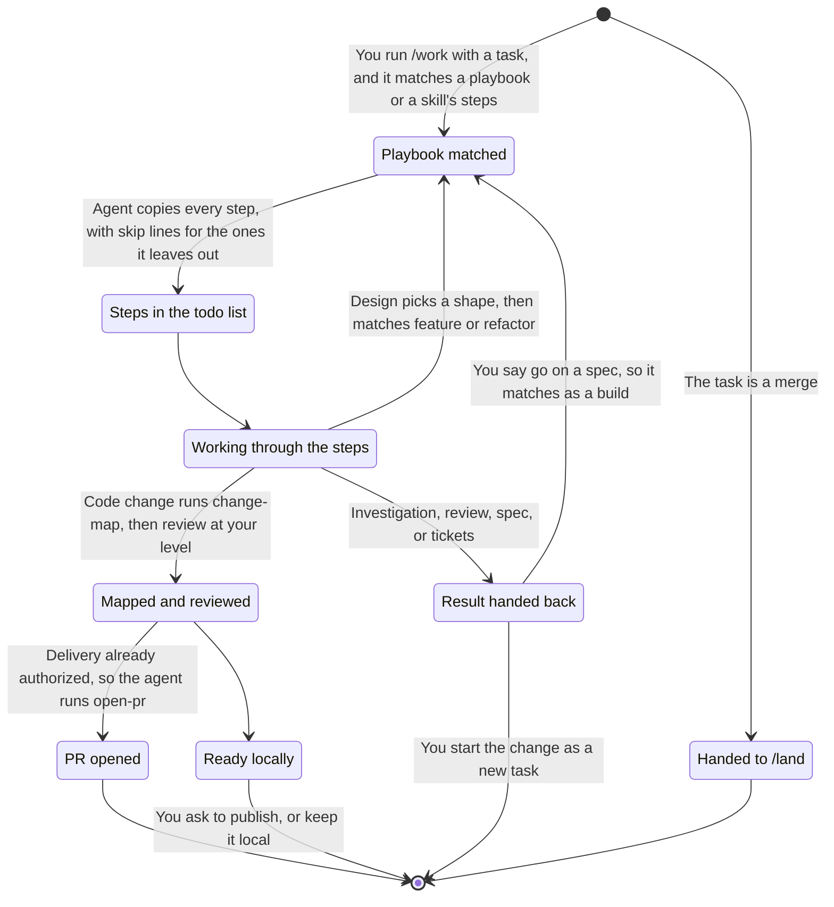
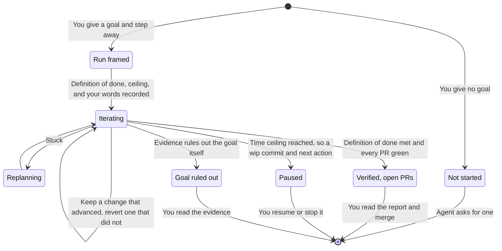
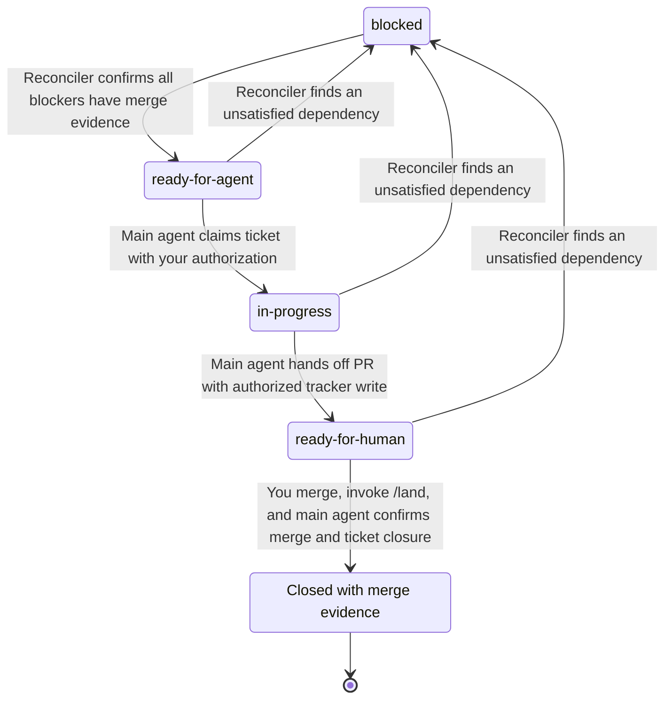
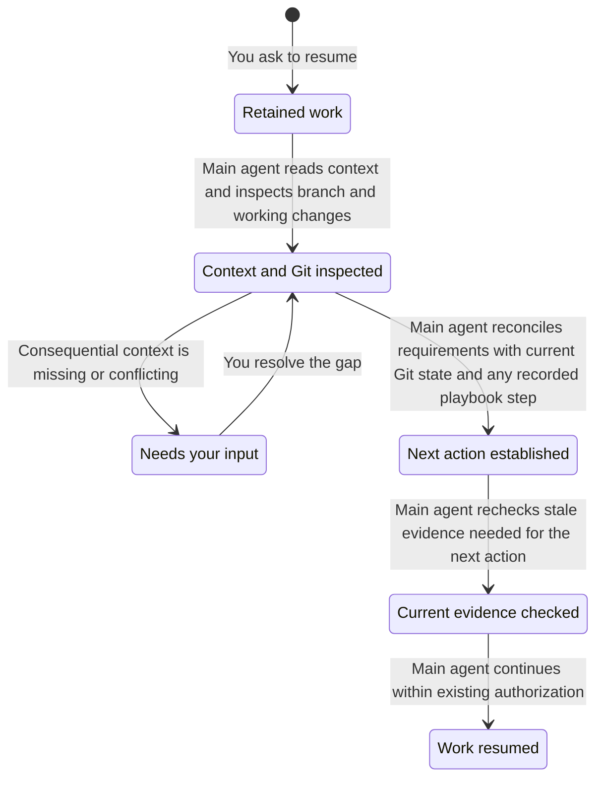

# Working with the harness

Start with a plain request. The agent inspects the repository, implements the agreed scope, checks it, and reports. You do not need a ticket, specification, or ceremony for ordinary work.

When you want the work run to a fixed set of steps, start it with `/work <task>`; see [Work mode](#work-mode).

## Choose help when you need it

| Situation | Skill |
| --- | --- |
| An everyday task or one ticket needs implementation with TDD | `implement` |
| A fuzzy idea needs decisions | `/grill-with-docs` |
| A ticket needs investigation before implementation | `/triage` |
| A question needs evidence | `research` |
| An experiment would settle an uncertainty | `proto` |
| A design needs a durable specification | `/spec` |
| A spec, a triage brief, findings, or a request needs tickets | `/tickets` |
| A bug needs reproduction and diagnosis | `diagnosing-bugs` |
| You want test-first implementation | `tdd` |
| A frontend needs design work | `impeccable` |
| A state machine needs model checking | `/statechart` |
| Code needs a durable formal check of a model or proof | `/create-formal-verification-skill` |
| A formal check may be stale after merges or refactors | `/maintain-formal-verification-skill` |
| The project needs a scripted way to drive the real app | `/create-verification-skill` |
| A project verify skill or its feature map may have drifted | `/maintain-verification-skill` |
| A feature, bugfix, PR, or path needs a real end-to-end run | `/e2e-verification` |
| A session needs a retrospective | `/retro` |

These are independent tools. Outside `/work`, using one does not require or automatically start another; inside it, the playbook decides which run and in what order. A slash marks an explicit invocation here; consult each skill for its inputs.

Use `/implement <task or ticket>` for everyday implementation with TDD in the current session. It accepts a plain request, reuses agreed test seams or settles them with you, and finishes with local checks. It uses one task branch; `/build` adds unattended orchestration across slices and workers.

## Work mode

`/work <task>` matches the task to one playbook and copies its steps into the agent's todo list. A playbook is either work mode's own (bug fix, feature, investigate, refactor, perf, design, or large) or an existing skill's steps: a prototype runs `proto`, a plan `spec`, tickets `tickets`, a settled spec or tickets `build`, a review `review`, an open PR's feedback `address-review`, and "open a PR" `open-pr`. Work mode adds its principle triggers, the todo list, and its reply, never a second copy of a skill's procedure. A step the agent decides not to take stays in the list as `skip: <reason>`. A code change ends with `change-map` and `review` at your review level, and goes on to `open-pr` when you already asked for delivery. An investigation, a review, a spec, or tickets hand the result back to you, and a design picks a shape, then continues as a feature or a refactor. A spec asks whether to build it, and only an explicit go answers; the go is a new task, so it matches again as a settled spec and runs `build`. Open decisions get settled with `/grill-with-docs` first. A merge goes to you or `/land`. Work mode lasts the conversation, and the playbook and step are recorded in the task document so a compaction resumes at the same step.

### Autopilot

Add "autopilot" or "I'm stepping away" and a goal to the `/work` request. The agent states a pass/fail definition of done (proposing one if you gave none), records your words and the time ceiling (2 hours unless you set one) in the task document, and works without checkpoints. It may commit, push, and open ready pull requests, including separate pull requests for fixes it finds along the way. It never merges, writes to the tracker, or messages anyone. Decisions only you could make get the simplest safe default and lead its report, each with what to tell it to switch. When two fixes resting on one assumption fail, it tests the assumption directly. When a piece fails, it retries by the cause (a smaller scope, the same start, or a different model), and after two retries drops that piece and plans around it.

## Local work and delivery

An implementation request authorizes local edits and commits on a task branch the agent creates. Consequential decisions come back to you; routine reversible choices do not need repeated approval.

“Open a PR” or “ship this” authorizes commits, push, PR creation or updates, and required-check repairs. Feedback stays on the same branch. Publication does not authorize merging. The agent ends with a readiness report: required checks, mergeability, review coverage, the run-as-user verdict, and open findings. You merge; then `/land` cleans up. `/land merge` has the agent recheck the gates and merge for you.

Before handoff, the agent runs the repository checks and explains what changed, what to review, and any gaps. When the project has a verify skill (made with `/create-verification-skill`), a separate agent that never saw the implementation drives the changed features the way a user would and returns PASS, PASS+NOTES, or FAIL; for a bugfix it shows the bug on the old code and its absence on the new. [Review coverage](review.md) follows your `harness review level` setting. At `medium` and `high`, a PR above `tests-docs` needs a review of its current patch: the readiness report shows whether it has one, and `/land merge` refuses to merge without it.

The [README state diagram](../README.md#everyday-use) shows the delivery path:

- **Ready locally:** the requested local work and applicable checks are complete. No publication is required.
- **Preparing PR:** publication is authorized. The agent completes local checks and applicable review before publishing.
- **PR open:** remote checks and feedback may require more changes on the same branch. Changed code needs fresh checks and any applicable review.
- **Ready to merge:** required checks and review are satisfied, and the readiness report says so. You merge, or run `/land merge` to have the agent recheck the gates and merge.
- **Needs your input:** a consequential decision or unavailable required check or reviewer blocks progress. Once resolved, work returns to the blocked stage. A failed check the agent can repair stays in the normal work loop.

These describe the intended workflow, not a centrally enforced task status. Live agent compliance is separate from the written floor and skills.

See [what happens to a finding](review.md#what-happens-to-a-finding) for how review concerns are proven or dropped, repaired, and rechecked.

For longer work, the agent keeps requirements, decisions, evidence, and the next action in `docs/agents/tasks/<feature>.md`, committed on the task branch. It merges with the work and stays in the repository as the record of what was done and why. Small tasks need no extra document.

## Larger builds

Invoke `/build` to implement a set of tickets, or a specification cut into tickets, unattended. It uses one integration branch and bounded workers in separate worktrees. The parent verifies and commits their results, then checks and reviews the combined change. Publication still requires a delivery request; merging still requires `/land`.

Use this when the work is settled enough to delegate. Missing acceptance criteria, disputed test seams, or shared assumptions need resolving first. `/work` on a settled spec or set of tickets starts `/build` for you, and a spec without tickets is cut into them with `tickets` first, drafted locally. Under `/work` autopilot, your step-away request also counts as its delivery request.

## Optional tracking

Invoke `setup-harness` to configure a repository's tracker. GitHub mode installs labels and a lifecycle workflow; local mode stores status in Markdown. Ordinary coding needs neither.

GitHub dependencies become ready only when their blockers were closed by merged PRs. Closing an issue manually does not count. A parent closes when all required children have merge evidence. Tracker writes and ticket publication require an explicit request.

### GitHub ticket lifecycle

This tracks one actionable ticket enrolled in the lifecycle workflow, using the default label names. Repositories can configure different names. **Main agent** means your primary session. **Reconciler** means the installed GitHub workflow, not a subagent. A ready label does not authorize work to start.

- **ready-for-agent:** all blockers have merge evidence, or there are no blockers. The main agent rechecks the claim before taking it and must not overwrite another run's claim.
- **ready-for-human:** the PR is ready for human review, with required checks and applicable review satisfied. PR feedback stays on the existing branch. The label does not mean a human must implement the ticket.
- **blocked:** a blocker lacks merge evidence, including when its repository cannot be read. Reconciliation can replace an active label with this label. Otherwise it preserves active claims and handoffs.
- **Closed with merge evidence:** a merged PR closed the ticket. Manual closure alone does not release dependents. `/land` checks tracker reconciliation and applies scoped repairs if the workflow did not run.

A parent issue is a container, not an actionable ticket in this diagram. It closes only after every required child has merge evidence. Reopening and explicitly authorized ticket release are outside this delivery view. The diagram describes the written workflow and reconciler rules, not proof of live agent compliance.

## When work stops

The agent reports contradictory evidence, scope changes, or two failed fixes that rest on the same assumption instead of guessing indefinitely. The report should say what failed and what decision or evidence is needed next. Under autopilot it does not stop there: it tests the assumption directly, retries a failed piece at most twice, and replans around it, parking only a dead end that survives the replan.

An explicit request naming the commits, files, branches, or task worktrees to discard counts as approval of that scope. The agent inspects first and asks again only if the scope is ambiguous or additional work would be lost. Unrelated work and user worktrees must survive.

### Resume retained work

Resuming assumes the implementation still exists. The main agent uses the request, the task document, and the branch's commits and diff. A paused session leaves a `wip:` commit and an updated task document, so the next one picks up from there. Work already verified at an unchanged commit is trusted, not redone. A small task needs no recovery document.

Missing context blocks only dependent work. Old notes grant no new authority, and checks against a changed commit are stale. See [continuity](../skills/support/continuity/SKILL.md) for recovery details.
