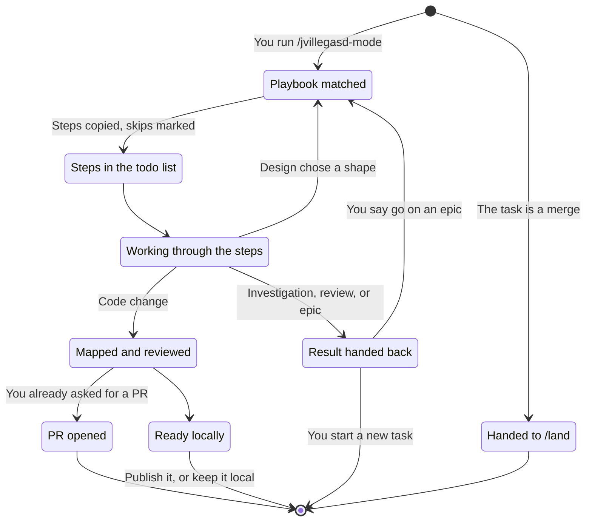
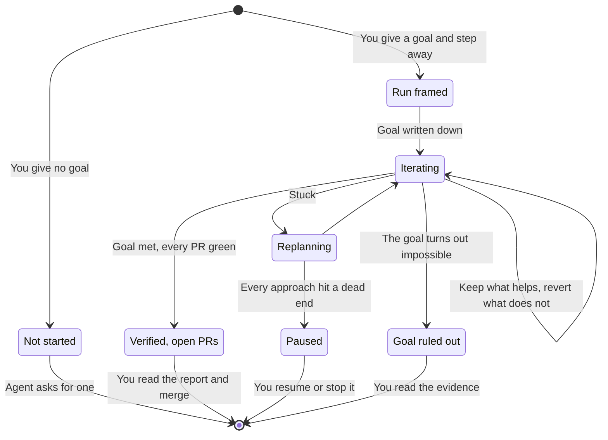
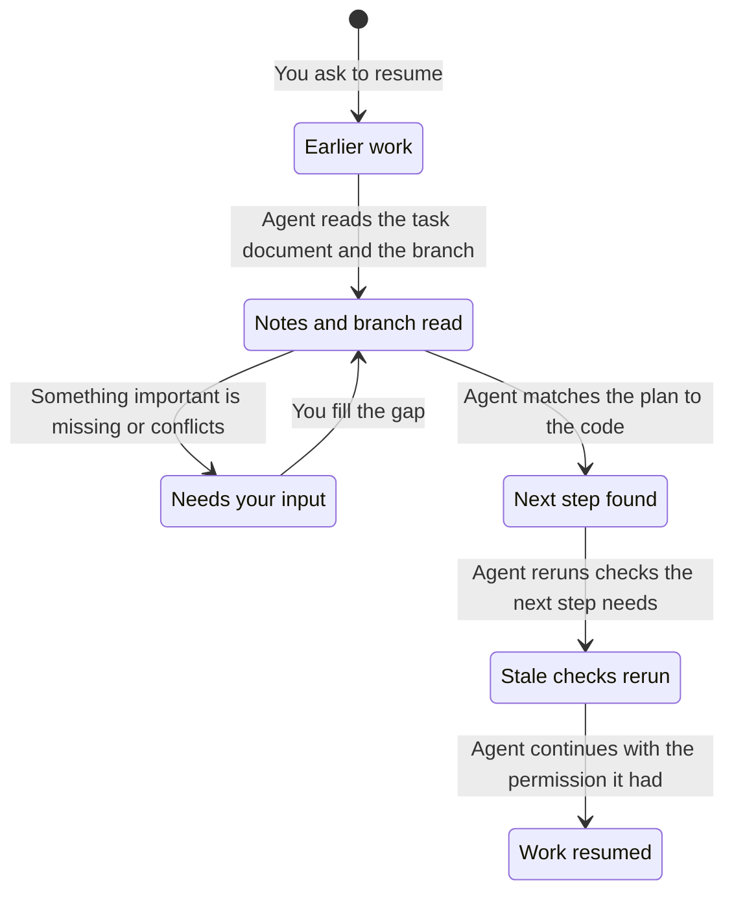

# Working with the harness

Start with a plain request. The agent reads the repository, does the agreed work, checks it, and reports back. Ordinary work needs no ticket, no specification, and no ceremony.

This guide covers what to reach for when a plain request is not enough:

- [Skills for specific jobs](#pick-a-skill-for-the-job)
- [jvillegasd-mode](#jvillegasd-mode), which runs a task to a fixed set of steps
- [Autopilot](#autopilot), for work that runs while you are away
- [The path from local work to a merged PR](#local-work-and-delivery)
- [Larger builds](#larger-builds) across several tickets
- [Issue tracking](#optional-tracking), if you want it
- [What happens when work stops](#when-work-stops), and how it resumes

## Pick a skill for the job

Every skill is callable by name. The skills you start yourself come first; the rest are helpers that `/jvillegasd-mode` or another skill runs as a step, and you can call any of them directly too. A leading slash, as in `/land`, means you call the skill by name.

### Skills you start

| Situation | Skill |
| --- | --- |
| Any task you want run to a playbook: plan, build, review, ship, diagnose, measure | `/jvillegasd-mode <task>` |
| A fuzzy idea needs decisions, recorded as ADRs and glossary terms | `/grill-with-docs` |
| A merged pull request needs its lifecycle closed, or you want the agent to merge | `/land` |
| Old worktrees, branches, and review scratch pile up | `/cleanup` |
| A repository needs its tracker and critical paths configured | `/setup-harness` |
| Agents keep repeating the same mistakes in a repository | `/correct` |
| The project needs a scripted way to drive the real app | `/create-verification-skill` |
| A project's verify skill or its feature map may have drifted | `/maintain-verification-skill` |
| Code needs a lasting formal check of a model or proof | `/create-formal-verification-skill` |
| A formal check may be out of date after merges or refactors | `/maintain-formal-verification-skill` |
| A state machine needs model checking | `/statechart` |
| A codebase needs a scan for deepening opportunities | `/improve-codebase-architecture` |
| A frontend needs design, critique, or polish work (also called by the design playbook) | `impeccable` |
| Frontend code needs current web platform APIs and their fallbacks | `modern-web-guidance` |
| Documentation needs a technical-writing pass | `technical-writing` |
| A reply did not land and needs a simpler re-pitch with context | `/wait-what` |
| You want to learn a topic over several sessions, in a directory kept for that course | `/teach <topic>` |

### Helpers other skills run

| Group | Helpers |
| --- | --- |
| Orchestration | `delegation`, `checkpoint` |
| Investigation | `how`, `why`, `research`, `diagnosing-bugs` |
| Planning | `epic` (write the big ticket, agree its seams, cut its slices), `proto`, `grilling` |
| Building | `build` (one slice inline with `tdd`, or many slices fanned out), `tdd` |
| Delivery | `review`, `address-review`, `open-pr`, `change-map`, `caveman-commit` |
| Assurance | `verify-work`, `security-audit` |
| Design | `codebase-design`, `domain-modeling` |
| Writing | `writing-for-agents`, `unslop` |
| Principles | the `principle-*` skills and `benchmark-checklist`, which the mode's trigger list names |

### Choose a verification skill

Three skills prove that a change works, and each one answers a different question:

| You want | Skill | What it leaves |
| --- | --- | --- |
| To know whether a change is safe to merge | `verify-work`, which runs on its own before a PR opens | A run-as-user verdict comment that `/land` reads |
| Tests of a flow that stay in the repository | `tdd` | Tests and fixtures in the project's own test suite |
| A way for agents to drive the real app at all | `/create-verification-skill` | A `verify-<app>` skill and a feature map |

The verdict drives the app through `verify-<app>`, so create that skill first. `verify-work` decides which features a PR touches and how a bugfix runs on the old code and then the new code. When the app changes and the feature map falls behind, run `/maintain-verification-skill`.

## jvillegasd-mode

`/jvillegasd-mode <task>` makes the agent follow a playbook: a fixed list of steps for that kind of task. The agent copies every step into its todo list. A step it decides to skip stays in the list as `skip: <reason>`, so you see what was left out and why.

The agent picks the playbook from the task:

| The task | What runs |
| --- | --- |
| Something is broken, throwing, or failing | Bug fix playbook |
| New or changed behavior | Feature playbook |
| A question (how, why, are we sure, should we), or a ticket or production error to analyze | Investigate playbook (read-only) |
| The structure changes, the behavior does not | Refactor playbook |
| Something is slow, with a number to move | Perf playbook |
| One metric to climb toward a target over many attempts | Hillclimb playbook |
| A runtime symptom or a captured profile to diagnose, with no fix | Forensics playbook (read-only) |
| A shape or interface to choose, with no precedent | Design playbook |
| Write or change a skill, an `AGENTS.md`, or a `CLAUDE.md` | `writing-for-agents`, then the repository's checks |
| A prototype, spike, or mock-up | `proto`'s steps |
| A plan before anything is built, or tickets from a brief, findings, or a request | `epic`'s steps |
| A settled epic or set of slices to build | `build`'s steps |
| Review a diff, a branch, or a PR | `review`'s steps |
| Feedback or red checks on an open PR | `address-review`'s steps |
| "Open a PR" or "ship this" | `open-pr`'s steps |
| A merge, or "it merged, clean up" | Nothing. The agent tells you to run `/land` |
| "Clean up old worktrees" | Nothing. The agent tells you to run `/cleanup` |
| Pick up earlier work | `checkpoint`'s resume steps, then the recorded playbook |
| Large, multi-part, or none of the above | You-got-this playbook |

When a row names a skill, jvillegasd-mode runs that skill's own steps. It adds its checklist and its reply, never a second copy of the skill.

How each kind of task ends:

- **A code change** ends with a change summary (`change-map`), a review at your review level, and `open-pr`, unless you said to keep it local.
- **An investigation, a review, or an epic** hand the result back to you.
- **A design** picks a shape, then continues as a feature or a refactor.
- **An epic** continues into `build`, unless you asked only for the plan.

Where a skill would ask you something, the agent makes the simplest safe choice, records it, and lists it first in its reply with what to say to switch. It still asks once about a product call no experiment can settle, and keeps working on everything else meanwhile. To think a fuzzy idea through first, use `/grill-with-docs`. A merge always goes to you or `/land`.

jvillegasd-mode lasts for the whole conversation. Long or unattended work keeps a task document, where the agent records the playbook and the current step, so after a compaction it resumes at the same step. Short work keeps no document: its decisions go in the reply and the PR.



### Autopilot

To let work run while you are away, add "autopilot" or "I'm stepping away" and a goal to the `/jvillegasd-mode` request:

```text
/jvillegasd-mode autopilot: make the export job finish under a minute
```

Here is what the agent does:

1. **Frames the run.** It states a pass or fail definition of done, or proposes one if you gave none. It records your words in the task document. There is no time limit.
2. **Works without checking in.** It keeps each change that moves toward the goal and reverts each one that does not.
3. **Decides for you where it must.** A decision only you could make gets the simplest safe option. Each one is listed at the top of its report, with what to tell it if you want something else.
4. **Handles getting stuck.** When two fixes that rest on one assumption both fail, it tests the assumption directly. When a piece fails, it retries based on the cause (a smaller scope, the same start, or a different model). After two retries it drops that piece and plans around it.

What it may and may not do:

- **May:** commit, push, and open ready pull requests, including separate PRs for problems it finds along the way.
- **Merge only with full:** it leaves the PRs stacked for you to land. With `full` in the request, it lands its own verified PRs bottom-up through `/land`'s steps, and stops at any hold only you can accept.
- **Never:** write to the issue tracker or message anyone.



## Local work and delivery

### What each request allows

| You say | The agent may |
| --- | --- |
| Any request to build something | Edit files and commit on a task branch it creates, then push it, open the PR, and fix required checks once the work is done. Feedback on that PR stays on the same branch |
| "Keep it local" | Stop before the push |
| `/land merge` | Recheck the gates and merge for you |
| `/land merge 19 20` or `/land merge stack 23` | Land those PRs, or the stack under PR 23, bottom-up one at a time, even when their branches are not checked out, and even when one comes from a fork. It stops at the first PR that fails a gate |

Publishing a PR never allows merging. You merge, then run `/land` to clean up.

`/land` asks [`harness land check`](cli.md#land-commands) whether each PR can land and stops on anything it holds. On `/land merge`, it merges through `harness land merge`, which checks the PR again and refuses to merge if its head moved or a GitHub gate holds it, such as a red or pending required check. A hold only you can clear, such as a `FAIL` review verdict, goes ahead only after you accept that hold by name. The merge never deletes the branch, and `/land` counts it done only once GitHub reports the PR merged. After the merge, `harness land finish` updates the default branch and removes the branch, worktree, and review scratch, and `harness land repair` moves a PR of yours that was stacked on a squash-merged one onto the default branch. On a PR someone else wrote, it merges and cleans up your side only: their remote branch stays, and a PR of theirs stacked on it is reported for them to rebase.

`/land` cleans up the PR it lands. For everything else that piles up (a PR someone merged on GitHub, an abandoned branch, a run that died), run `/cleanup`. It lists every worktree with what removing it would delete, and removes only the ones you name.

The agent brings important decisions back to you. Small choices that are easy to undo do not need your approval each time.

### Before the agent hands off

- It runs the repository's checks and explains what changed, what to review, and any gaps.
- If the project has a verify skill (made with `/create-verification-skill`), a separate agent that never saw the code drives the changed features the way a user would. It returns PASS, PASS+NOTES, or FAIL, and the agent posts that as a run-as-user verdict comment on the PR. For a bugfix, it shows the bug on the old code and its absence on the new code. A PR whose change you can observe (`critical` or `behavioral`) needs one that covers its current code: `/land merge` refuses without it until you accept that by name, which is every time in a project that has no verify skill yet.
- [Review](review.md) runs according to your `harness review level`. At `medium` and `high`, a PR beyond docs or tests needs a review of its current changes. The readiness report shows whether it has one, and `/land merge` refuses to merge without it.

A PR ends with a readiness report: required checks, whether it can merge, the review verdict and whether it covers the head, and the run-as-user verdict. The agent builds it from [`harness pr status`](cli.md#pr-commands), which you can run yourself on any PR. The review's result and the run-as-user result are each their own verdict comment on the PR, never part of the PR body.

### The stages

The [diagram in the README](../README.md#what-the-agent-does-on-its-own-and-what-waits-for-you) shows the whole path. Each stage means:

- **Ready locally:** the local work and its checks are done. You do not have to publish it.
- **Preparing PR:** you asked to publish. The agent finishes the local checks and any review before it publishes.
- **PR open:** remote checks and feedback may need more changes on the same branch. Changed code needs fresh checks and any applicable review.
- **Ready to merge:** required checks and review pass, and the readiness report says so. You merge, or run `/land merge` to have the agent recheck the gates and merge.
- **Needs your input:** an important decision, or a required check or reviewer that cannot run, blocks progress. Once you resolve it, work returns to the stage that was blocked. A failed check the agent can fix is not a blocker. It stays in the normal work loop.

These stages describe the intended workflow. Nothing enforces them centrally, and the written rules are not proof of how a live agent behaves. For how review concerns are proven, dropped, fixed, and rechecked, see [what happens to a finding](review.md#what-happens-to-a-finding).

### Task documents

For long or unattended work, the agent keeps the requirements, decisions, evidence, and next step in `docs/agents/tasks/<feature>.md`. It stays local: `harness resume init` excludes the folder from Git, so it is never committed, and `/land` throws it away with the worktree once the work merges. Its decisions reach you through the PR's tradeoffs, the plan lives in the epic (`docs/agents/epics/`), and lasting decisions become ADRs. Small tasks do not need one.

## Larger builds

`build` implements an epic's slices without you watching:

- It plans one small pull request per slice before writing code. A slice that builds on another is stacked on it, and a slice that builds on nothing branches from the default branch on its own.
- The blast radius decides what may share a pull request. A slice that touches a critical path or is hard to reverse always gets its own. Only small, low-risk slices, such as docs beside the behavior they describe, share one.
- Workers each take one slice, in their own worktrees.
- The main agent checks and commits each worker's result on its slice's branch, then verifies, maps, and reviews each branch on its own, from the bottom of the stack up.

`/jvillegasd-mode` on a settled epic starts `build` for you. An epic without slices is first cut into them, as local drafts that [`harness tickets check`](cli.md#ticket-commands) validates. `build` picks the next slices with `harness tickets frontier`: those whose blockers are all done. Publishing still needs your request, and merging still needs `/land`, one pull request at a time; after a parent merges, `/land` repairs the pull requests stacked on it. Pull requests open on their own once the work is verified, unless you said to keep it local.

Larger work, such as a whole app, matches the you-got-this playbook. It frames the work, and when the work splits into slices that can be settled now, it runs `epic` and then `build`.

## Optional tracking

Ordinary coding needs no tracker. To set one up for a repository, run `setup-harness`. It writes `docs/agents/harness.json` with the tracker and the critical paths `change-map` reads. The harness installs no labels and no lifecycle workflow: ticket state is the tracker's own open, closed, and blocked-by state, and `build` computes what is ready from merged work.

Tracker writes and publishing tickets always need your explicit request. When you ask to publish, `harness tickets publish` creates the issues, blockers first, with native dependency links, and is safe to rerun after a failure. After a merge, `/land` confirms the ticket closed and closes a parent once every child merged. The [command-line reference](cli.md#ticket-commands) covers the command.

## When work stops

The agent stops and reports instead of guessing when:

- the evidence contradicts what the task assumed, or
- the next step would go beyond what you asked for.

When two fixes that rest on the same assumption both fail, it tests that assumption directly before trying another fix. It stops and reports only when the test shows the assumption is wrong and it has no new one.

The report says what failed and what decision or evidence it needs next. Autopilot works differently: it tests the assumption directly, retries a failed piece at most twice, and plans around it. It parks only a dead end that survives the replan.

### Discarding work

When you name specific commits, files, branches, or task worktrees to discard, that counts as approval for exactly that scope. The agent looks first, and asks again only if the scope is unclear or more work would be lost. Unrelated work and your own worktrees always survive.

### Resume earlier work

To resume, the work must still exist. The agent rebuilds the picture from your request, the task document, and the branch's commits and diff:

- A paused session leaves a `wip:` commit and an updated task document, so the next session starts from there.
- Work that was already verified at an unchanged commit is trusted, not redone.
- A check run against a commit that has since changed is stale and runs again.
- Missing context blocks only the work that depends on it.
- Old notes never grant new permission.

A small task needs no recovery document.



The [checkpoint skill](../skills/orchestration/checkpoint/SKILL.md) has the full recovery details.
