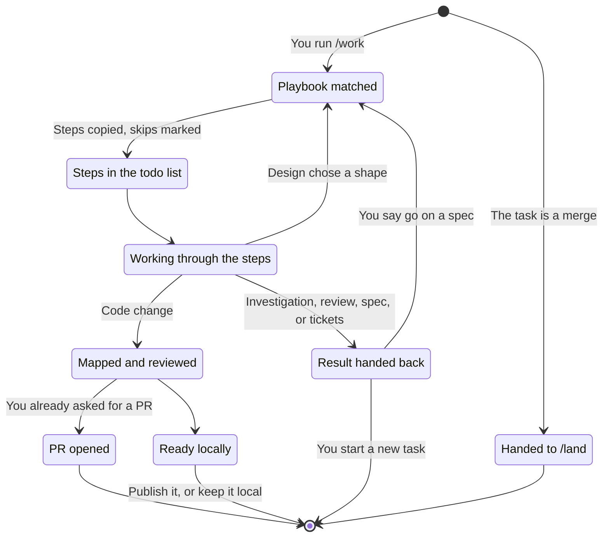
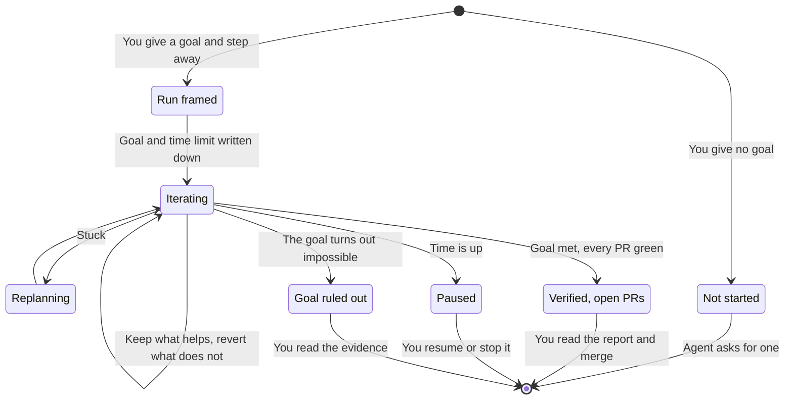
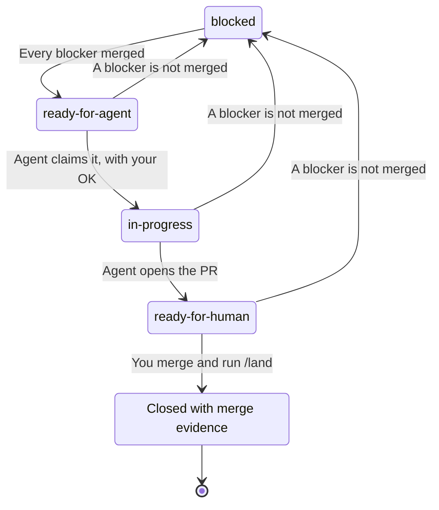
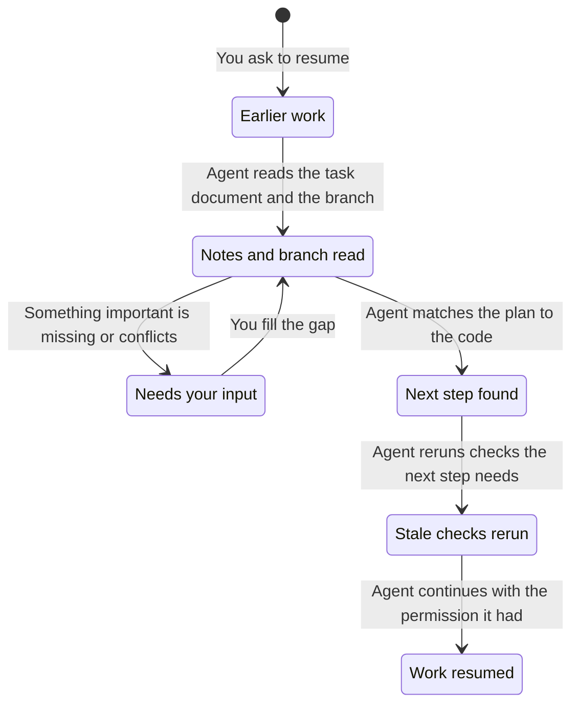

# Working with the harness

Start with a plain request. The agent reads the repository, does the agreed work, checks it, and reports back. Ordinary work needs no ticket, no specification, and no ceremony.

This guide covers what to reach for when a plain request is not enough:

- [Skills for specific jobs](#pick-a-skill-for-the-job)
- [Work mode](#work-mode), which runs a task to a fixed set of steps
- [Autopilot](#autopilot), for work that runs while you are away
- [The path from local work to a merged PR](#local-work-and-delivery)
- [Larger builds](#larger-builds) across several tickets
- [Issue tracking](#optional-tracking), if you want it
- [What happens when work stops](#when-work-stops), and how it resumes

## Pick a skill for the job

Each skill is a separate tool. Outside work mode, using one never starts another. A leading slash, as in `/spec`, means you call the skill by name. Each skill describes its own inputs.

### Plan

| Situation | Skill |
| --- | --- |
| A fuzzy idea needs decisions | `/grill-with-docs` |
| A ticket needs investigation before anyone builds it | `/triage` |
| A question needs evidence | `research` |
| An experiment would settle an open question | `proto` |
| A design needs a lasting specification | `/spec` |
| A spec, a triage brief, findings, or a request needs tickets | `/tickets` |

### Build

| Situation | Skill |
| --- | --- |
| An everyday task or one ticket needs building, test-first | `implement` |
| You want to write the tests before the code | `tdd` |
| A bug needs reproducing and diagnosing | `diagnosing-bugs` |
| A frontend needs design work | `impeccable` |
| Frontend code needs current web platform APIs and their fallbacks | `modern-web-guidance` |

### Verify

| Situation | Skill |
| --- | --- |
| A state machine needs model checking | `/statechart` |
| Code needs a lasting formal check of a model or proof | `/create-formal-verification-skill` |
| A formal check may be out of date after merges or refactors | `/maintain-formal-verification-skill` |
| The project needs a scripted way to drive the real app | `/create-verification-skill` |
| A project's verify skill or its feature map may have drifted | `/maintain-verification-skill` |
| A feature, bugfix, PR, or path needs a real end-to-end run | `/e2e-verification` |
| A test suite may carry tests that protect nothing | `/test-audit` |

### Reflect

| Situation | Skill |
| --- | --- |
| A session needs a retrospective | `/retro` |

### `/implement` or `/build`?

- **`/implement <task or ticket>`** builds one thing, test-first, in your current session, on one task branch. It takes a plain request, reuses test seams you already agreed on (or settles them with you), and finishes with the local checks.
- **`/build`** runs many tickets unattended, with several workers. See [larger builds](#larger-builds).

## Work mode

`/work <task>` makes the agent follow a playbook: a fixed list of steps for that kind of task. The agent copies every step into its todo list. A step it decides to skip stays in the list as `skip: <reason>`, so you see what was left out and why.

The agent picks the playbook from the task:

| The task | What runs |
| --- | --- |
| Something is broken, throwing, or failing | Bug fix playbook |
| New or changed behavior | Feature playbook |
| A question: how, why, are we sure, should we | Investigate playbook (read-only) |
| The structure changes, the behavior does not | Refactor playbook |
| Something is slow, with a number to move | Perf playbook |
| One metric to climb toward a target over many attempts | Hillclimb playbook |
| A runtime symptom or a captured profile to diagnose, with no fix | Forensics playbook (read-only) |
| A shape or interface to choose, with no precedent | Design playbook |
| Write or change a skill, an `AGENTS.md`, or a `CLAUDE.md` | Skill playbook |
| Whether a skill or instruction change changes agent behavior | Eval playbook |
| A prototype, spike, or mock-up | `proto`'s steps |
| A spec or plan, before anything is built | `spec`'s steps |
| A ticket or production error to analyze, with no fix requested | `triage`'s steps |
| Tickets from a spec, a brief, findings, or a request | `tickets`' steps |
| A settled spec or set of tickets to build | `build`'s steps |
| Review a diff, a branch, or a PR | `review`'s steps |
| Feedback or red checks on an open PR | `address-review`'s steps |
| "Open a PR" or "ship this" | `open-pr`'s steps |
| A merge, or "it merged, clean up" | Nothing. The agent tells you to run `/land` |
| Pick up earlier work | `continuity`'s resume steps, then the recorded playbook |
| Large, multi-part, or none of the above | Large playbook |

When a row names a skill, work mode runs that skill's own steps. It adds its checklist and its reply, never a second copy of the skill.

How each kind of task ends:

- **A code change** ends with a change summary (`change-map`) and a review at your review level. If you already asked for delivery, it goes on to `open-pr`.
- **An investigation, a review, a spec, or tickets** hand the result back to you.
- **A design** picks a shape, then continues as a feature or a refactor.
- **A spec** asks whether to build it. Only an explicit "go" answers. That go is a new task, so it matches again as a settled spec and runs `build`.

If product decisions are still open, settle them with `/grill-with-docs` before you start. A merge always goes to you or `/land`.

Work mode lasts for the whole conversation. The agent records the playbook and the current step in the task document, so after a compaction it resumes at the same step.



### Autopilot

To let work run while you are away, add "autopilot" or "I'm stepping away" and a goal to the `/work` request:

```text
/work autopilot, max 3h: make the export job finish under a minute
```

Here is what the agent does:

1. **Frames the run.** It states a pass or fail definition of done, or proposes one if you gave none. It records your words and the time limit (2 hours unless you set one) in the task document.
2. **Works without checking in.** It keeps each change that moves toward the goal and reverts each one that does not.
3. **Decides for you where it must.** A decision only you could make gets the simplest safe option. Each one is listed at the top of its report, with what to tell it if you want something else.
4. **Handles getting stuck.** When two fixes that rest on one assumption both fail, it tests the assumption directly. When a piece fails, it retries based on the cause (a smaller scope, the same start, or a different model). After two retries it drops that piece and plans around it.

What it may and may not do:

- **May:** commit, push, and open ready pull requests, including separate PRs for problems it finds along the way.
- **Never:** merge, write to the issue tracker, or message anyone.



## Local work and delivery

### What each request allows

| You say | The agent may |
| --- | --- |
| Any request to build something | Edit files and commit on a task branch it creates |
| "Open a PR" or "ship this" | Also push, open or update the PR, and fix required checks. Feedback on that PR stays on the same branch |
| `/land merge` | Recheck the gates and merge for you |
| `/land merge 19 20` or `/land merge stack 23` | Land those PRs, or the stack under PR 23, bottom-up one at a time, even when their branches are not checked out. It stops at the first PR that fails a gate |

Publishing a PR never allows merging. You merge, then run `/land` to clean up.

The agent brings important decisions back to you. Small choices that are easy to undo do not need your approval each time.

### Before the agent hands off

- It runs the repository's checks and explains what changed, what to review, and any gaps.
- If the project has a verify skill (made with `/create-verification-skill`), a separate agent that never saw the code drives the changed features the way a user would. It returns PASS, PASS+NOTES, or FAIL. For a bugfix, it shows the bug on the old code and its absence on the new code.
- [Review](review.md) runs according to your `harness review level`. At `medium` and `high`, a PR beyond docs or tests needs a review of its current changes. The readiness report shows whether it has one, and `/land merge` refuses to merge without it.

A PR ends with a readiness report: required checks, whether it can merge, review coverage, the run-as-user verdict, and open findings.

### The stages

The [diagram in the README](../README.md#what-the-agent-does-on-its-own-and-what-waits-for-you) shows the whole path. Each stage means:

- **Ready locally:** the local work and its checks are done. You do not have to publish it.
- **Preparing PR:** you asked to publish. The agent finishes the local checks and any review before it publishes.
- **PR open:** remote checks and feedback may need more changes on the same branch. Changed code needs fresh checks and any applicable review.
- **Ready to merge:** required checks and review pass, and the readiness report says so. You merge, or run `/land merge` to have the agent recheck the gates and merge.
- **Needs your input:** an important decision, or a required check or reviewer that cannot run, blocks progress. Once you resolve it, work returns to the stage that was blocked. A failed check the agent can fix is not a blocker. It stays in the normal work loop.

These stages describe the intended workflow. Nothing enforces them centrally, and the written rules are not proof of how a live agent behaves. For how review concerns are proven, dropped, fixed, and rechecked, see [what happens to a finding](review.md#what-happens-to-a-finding).

### Task documents

For longer work, the agent keeps the requirements, decisions, evidence, and next step in `docs/agents/tasks/<feature>.md`, committed on the task branch. It merges with the work and stays in the repository as a record of what was done and why. Small tasks do not need one.

## Larger builds

`/build` implements a set of tickets, or a specification cut into tickets, without you watching:

- It works on one integration branch.
- Workers each take a bounded piece, in their own worktrees.
- The main agent checks and commits each worker's result, then checks and reviews the combined change.

Use it when the work is settled enough to hand off. Resolve missing acceptance criteria, disputed test seams, or shared assumptions first.

`/work` on a settled spec or set of tickets starts `/build` for you. A spec without tickets is first cut into them with `tickets`, as local drafts. Publishing still needs your request, and merging still needs `/land`. Under `/work` autopilot, your step-away request also counts as the request to publish.

## Optional tracking

Ordinary coding needs no tracker. To set one up for a repository, run `setup-harness`. It offers two modes:

- **GitHub mode** installs labels and a workflow that moves tickets through their lifecycle.
- **Local mode** keeps ticket status in Markdown files.

Tracker writes and publishing tickets always need your explicit request.

### How GitHub tickets move

A ticket becomes ready only when every ticket blocking it was closed by a merged PR. Closing an issue by hand does not count. A parent issue closes when all its required children have merge evidence.

The diagram follows one ticket through the default labels (a repository can rename them). **Main agent** means your primary session. **Reconciler** means the installed GitHub workflow, not a subagent. A ready label does not by itself allow work to start.



What each label means:

- **`ready-for-agent`:** every blocker has merge evidence, or there are no blockers. The main agent rechecks before it claims the ticket, and never overwrites another run's claim.
- **`in-progress`:** the main agent has claimed the ticket, with your authorization.
- **`ready-for-human`:** the PR is ready for your review, with required checks and any applicable review passing. PR feedback stays on the same branch. The label does not mean a person has to build the ticket.
- **`blocked`:** a blocker has no merge evidence, including when its repository cannot be read. The reconciler can replace an active label with this one. Otherwise it keeps active claims and handoffs.
- **Closed with merge evidence:** a merged PR closed the ticket. Closing it by hand does not release the tickets that depend on it. `/land` checks the tracker and makes scoped repairs if the workflow did not run.

A parent issue is a container, not a ticket in this diagram. It closes only after every required child has merge evidence. Reopening a ticket and explicitly authorized releases are outside this view. The diagram describes the written workflow and the reconciler's rules, not proof of how a live agent behaves.

## When work stops

The agent stops and reports instead of guessing when:

- the evidence contradicts what the task assumed, or
- the next step would go beyond what you asked for.

When two fixes that rest on the same assumption both fail, it tests that assumption directly before trying another fix. It stops and reports only when the test shows the assumption is wrong and it has no new one.

The report says what failed and what decision or evidence it needs next. Autopilot works differently: it tests the assumption directly, retries a failed piece at most twice, and plans around it. It parks only a dead end that survives the replan.

### Discarding work

When you name specific commits, files, branches, or task worktrees to discard, that counts as approval for exactly that scope. The agent looks first, and asks again only if the scope is unclear or more work would be lost. Unrelated work and your own worktrees always survive.

### Resume earlier work

To resume, the work must still exist. The agent rebuilds the picture from your request, the task document, and the branch's commits and diff:

- A paused session leaves a `wip:` commit and an updated task document, so the next session starts from there.
- Work that was already verified at an unchanged commit is trusted, not redone.
- A check run against a commit that has since changed is stale and runs again.
- Missing context blocks only the work that depends on it.
- Old notes never grant new permission.

A small task needs no recovery document.



The [continuity skill](../skills/support/continuity/SKILL.md) has the full recovery details.
